# SYSPCC — Diagramas de Casos de Uso

**Sistema de Gestión de Requerimientos de Abastecimiento**
**Versión:** 1.1 | **Fecha:** Octubre 2026 | **Empresa:** PCC Ingeniería y Construcción

---

## 1. Diagrama General — Todos los Módulos

```mermaid
graph TB
    subgraph Actores
        REQ[👤 Solicitante<br/>REQUESTER]
        PR[👤 Residente de Proyecto<br/>PROJECT_RESIDENT]
        PC[👤 Control de Proyecto<br/>PROJECT_CONTROL]
        GM[👤 Gerente General<br/>GENERAL_MANAGER]
        LC[👤 Coordinador Logístico<br/>LOGISTICS_COORDINATOR]
        CW[👤 Almacén Central<br/>CENTRAL_WAREHOUSE]
        SW[👤 Almacén de Obra<br/>SITE_WAREHOUSE]
        DS[👤 Jefe Directo<br/>DIRECT_SUPERVISOR]
        AM[👤 Gerente Administrativo<br/>ADMIN_MANAGER]
        LS[👤 Supervisor Logístico<br/>LOGISTICS_SUPERVISOR]
        LCH[👤 Jefe Logístico<br/>LOGISTICS_CHIEF]
        PJ[👤 Gestor de Pasajes<br/>PASAJES_MANAGER]
        HRM[👤 Gestor de RR. HH.<br/>HR_MANAGER]
        SU[👤 Superadministrador<br/>is_superuser]
        TI[👤 Soporte TI<br/>is_staff]
        USR[👤 Cualquier usuario<br/>autenticado]
    end

    subgraph "Módulo RQ"
        UC1((Crear RQ))
        UC2((Enviar RQ))
        UC3((Aprobar/Rechazar))
        UC4((Gestionar Cotizaciones))
        UC5((Generar OC))
        UC6((Control de Calidad))
        UC7((Conformidad y Cierre))
        UC23((Vincular ítems<br/>al catálogo))
    end

    subgraph "Módulo Almacén"
        UC8((Registrar Ingreso))
        UC9((Registrar Egreso<br/>o Entrega con vale))
        UC10((Consultar Kardex y<br/>Resumen de Movimiento))
        UC11((Transferencia interna<br/>entre pisos))
        UC16((Importar Excel<br/>de inventario))
        UC17((Asignar Ubicación))
    end

    subgraph "Módulo Admin — Pasajes"
        UC12((Gestionar Pasajes))
        UC13((Configurar Políticas))
    end

    subgraph "Módulo Soporte"
        UC14((Crear Ticket))
        UC15((Gestionar Ticket))
    end

    subgraph "Módulo RR. HH."
        UC18((Gestionar Plantillas))
        UC19((Emitir Contrato))
        UC20((Analizar CVs))
    end

    subgraph "Administración del Sistema"
        UC21((Gestionar Usuarios<br/>y Roles))
        UC22((Gestionar Proyectos))
    end

    REQ --> UC1
    REQ --> UC2
    REQ --> UC7
    USR --> UC14
    PR --> UC3
    PC --> UC3
    GM --> UC3
    DS --> UC3
    AM --> UC3
    LC --> UC4
    LC --> UC5
    LC --> UC6
    LC --> UC7
    LC --> UC23
    LS --> UC4
    LS --> UC5
    LS --> UC6
    LS --> UC7
    LS --> UC23
    LCH --> UC4
    LCH --> UC23
    CW --> UC8
    CW --> UC9
    CW --> UC10
    CW --> UC11
    CW --> UC16
    CW --> UC17
    SW --> UC8
    SW --> UC9
    SW --> UC10
    SW --> UC11
    LCH --> UC16
    LCH --> UC17
    LC --> UC10
    LS --> UC10
    LCH --> UC10
    AM --> UC12
    AM --> UC13
    GM --> UC12
    GM --> UC13
    PJ --> UC12
    PJ --> UC13
    TI --> UC15
    HRM --> UC18
    HRM --> UC19
    HRM --> UC20
    GM -.->|solo lectura| UC19
    GM -.->|solo lectura| UC20
    SU --> UC21
    SU --> UC22
```

> **Nota sobre el acceso.** Un Solicitante crea RQ, pero el backend permite crearlos a cualquier usuario autenticado; la conformidad final sí exige el rol `REQUESTER`. El módulo Almacén y sus pantallas se limitan a los cinco roles de almacén y logística; los matices por acción (quién importa, quién asigna ubicaciones, quién entrega a trabajadores) están en la matriz de la sección 7.

---

## 2. Casos de Uso — Módulo de Requerimientos (RQ)

### 2.1 Diagrama de Casos de Uso del Módulo RQ

```mermaid
graph LR
    REQ[👤 Solicitante]
    PR[👤 Residente<br/>de Proyecto]
    PC[👤 Control<br/>de Proyecto]
    GM[👤 Gerente<br/>General]
    DS[👤 Jefe<br/>Directo]
    AM[👤 Gerente<br/>Administrativo]
    LC[👤 Coordinador<br/>Logístico]
    LS[👤 Supervisor<br/>Logístico]
    LCH[👤 Jefe<br/>Logístico]
    CW[👤 Almacén<br/>Central]
    SW[👤 Almacén<br/>de Obra]

    subgraph "FASE 1 — Solicitud"
        CU01((CU-01<br/>Crear RQ))
        CU02((CU-02<br/>Enviar RQ))
        CU01C((CU-01C<br/>Elegir producto<br/>del catálogo))
        CU01E((CU-01E<br/>Exportar a<br/>Excel))
    end

    subgraph "FASE 2 — Validación"
        CU03((CU-03<br/>Validación<br/>Técnica))
        CU04((CU-04<br/>Clasificación<br/>Presupuestal))
        CU05((CU-05<br/>Validación<br/>Administrativa))
        CU06((CU-06<br/>Aprobación<br/>Gerencia))
    end

    subgraph "FASE 3 — Logística y Compras"
        CU07((CU-07<br/>Verificar<br/>Stock))
        CU42((CU-42<br/>Vincular ítems<br/>y ver disponibilidad))
        CU08((CU-08<br/>Gestionar<br/>Cotizaciones))
        CU41((CU-41<br/>Aprobar costo<br/>o sobrecosto))
        CU09((CU-09<br/>Generar<br/>Orden Compra))
    end

    subgraph "FASE 4 — Recepción y Entrega"
        CU10((CU-10<br/>Recepción y<br/>Control Calidad))
        CU11((CU-11<br/>Despacho y<br/>Entrega))
        CU40((CU-40<br/>Reclamo a<br/>Proveedor))
    end

    subgraph "FASE 5 — Conformidad"
        CU12((CU-12<br/>Conformidad<br/>del Usuario))
        CU13((CU-13<br/>Cierre de RQ))
    end

    subgraph "Universal"
        CU14((CU-14<br/>Cancelar RQ))
    end

    REQ --> CU01
    REQ --> CU02
    CU01 -.->|include| CU01C
    CU01 -.->|extend| CU01E
    REQ --> CU12
    REQ --> CU14

    PR --> CU03
    PC --> CU04
    DS --> CU05
    AM --> CU05
    GM --> CU06

    LC --> CU07
    LC --> CU42
    LC --> CU08
    LC --> CU09
    LS --> CU07
    LS --> CU42
    LS --> CU08
    LS --> CU09
    LCH --> CU08
    LCH --> CU42
    PC --> CU41
    AM --> CU41
    GM --> CU41

    LC --> CU10
    LC --> CU11
    LC --> CU40
    LS --> CU10
    LS --> CU11
    LS --> CU40
    CW --> CU11
    SW --> CU11

    LC --> CU13
    LS --> CU13
```

### 2.2 Especificación Detallada de Casos de Uso

La acción que se envía al motor del flujo es siempre un valor de `ApprovalActionChoices` (por ejemplo `TECHNICAL_APPROVED`), junto con el rol con el que actúa el usuario (`acting_role`). El cuerpo de `POST /requests/{id}/action/` es:

```json
{ "action": "TECHNICAL_APPROVED", "acting_role": "PROJECT_RESIDENT", "comments": "...", "extra_data": {} }
```

`extra_data` solo admite las claves `classification`, `within_plan`, `has_stock` y `within_budget`.

#### CU-01: Crear Requerimiento

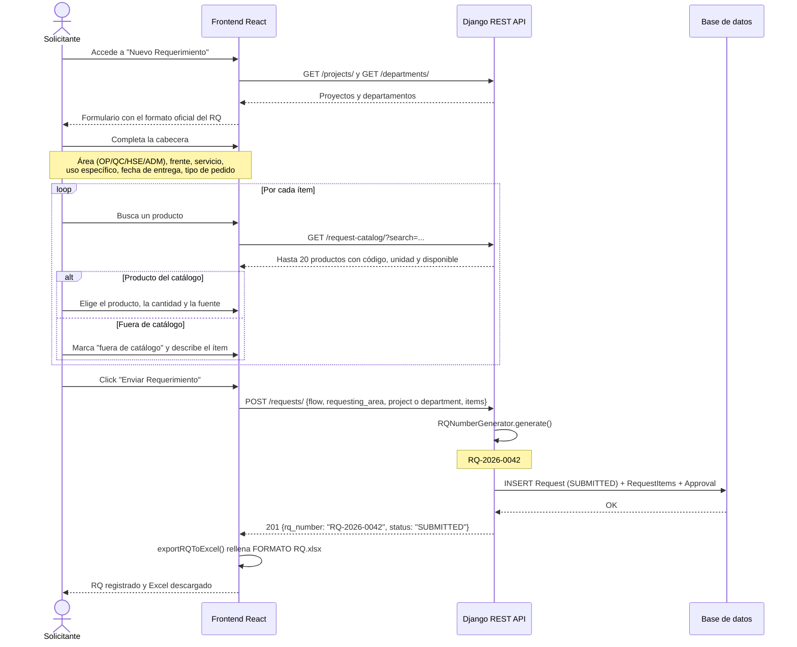

| Campo | Detalle |
|-------|---------|
| **ID** | CU-01 |
| **Nombre** | Crear Requerimiento |
| **Actor principal** | Solicitante (REQUESTER) |
| **Precondición** | Usuario autenticado con acceso al módulo `/rq` |
| **Flujo principal** | 1. Selecciona el destino: un proyecto (flujo Operaciones) o un departamento / Oficina Central (flujo Administrativo)<br>2. Completa área solicitante, frente, servicio, uso específico, fecha de entrega y tipo de pedido<br>3. Agrega ítems: elige un producto del catálogo del almacén o marca "fuera de catálogo", indica cantidad, unidad y fuente (EPP, herramientas, materiales, ...)<br>4. Envía el requerimiento |
| **Extensión** | E1 (CU-01E): descarga el Excel oficial `FORMATO RQ.xlsx` rellenado con ExcelJS (botón "Descargar Excel" o al enviar). "Enviar sin Excel" registra el RQ sin descargarlo |
| **Inclusión** | CU-01C: la búsqueda en el catálogo (`GET /request-catalog/`) está abierta a todo usuario autenticado, devuelve como máximo 20 filas y exige al menos 2 caracteres |
| **Postcondición** | RQ creado con número auto-generado (RQ-YYYY-NNNN) y estado SUBMITTED; el producto elegido es solo una **propuesta** que Logística confirma después |
| **Reglas de negocio** | - El número RQ lo genera el servidor, es secuencial por año y se ignora cualquier valor enviado por el cliente<br>- El área solicitante (OP, QC, HSE, ADM) es obligatoria al crear<br>- Flujo Operaciones exige proyecto; flujo Administrativo exige departamento; el frente "Oficina Central" siempre va por el flujo Administrativo<br>- La cantidad de cada ítem debe ser mayor que cero; de 1 a 200 ítems por RQ<br>- `total_price` de cada ítem se calcula como `quantity × unit_price` cuando hay precio unitario<br>- El Excel **no se sube**: el formato se rellena en el navegador a partir del formulario |

---

#### CU-02: Enviar Requerimiento

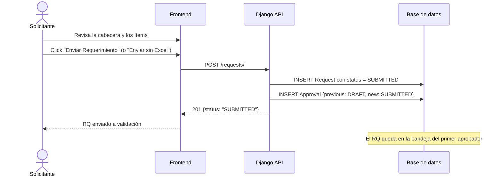

| Campo | Detalle |
|-------|---------|
| **ID** | CU-02 |
| **Nombre** | Enviar Requerimiento |
| **Actor principal** | Solicitante (REQUESTER) |
| **Precondición** | Cabecera completa y al menos un ítem válido |
| **Flujo principal** | 1. Pulsa "Enviar Requerimiento" o "Enviar sin Excel"<br>2. El backend crea el RQ ya en estado SUBMITTED y registra la aprobación `DRAFT → SUBMITTED` |
| **Postcondición** | RQ en estado SUBMITTED: aparece en la bandeja de Aprobaciones del Residente (Operaciones) o del Jefe Directo (Administrativo) |
| **Observaciones** | - La interfaz actual no deja borradores editables: ambos botones envían el RQ a validación<br>- El estado DRAFT y la acción `SUBMITTED` (DRAFT → SUBMITTED, rol REQUESTER) siguen definidos en la tabla de transiciones del motor<br>- La creación no dispara notificaciones; las notificaciones nacen de las transiciones posteriores |

---

#### CU-03: Validación Técnica (Flujo Operaciones)

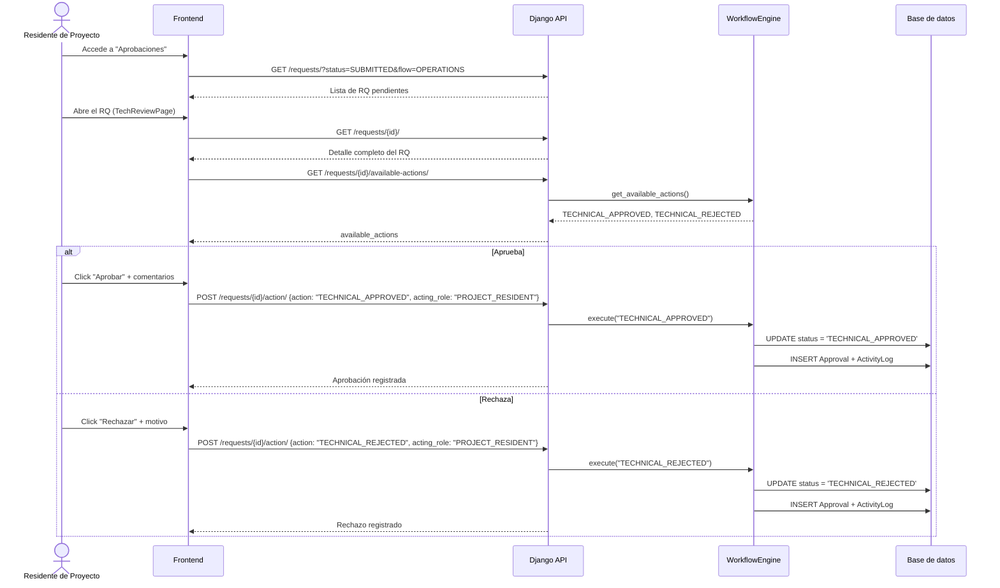

| Campo | Detalle |
|-------|---------|
| **ID** | CU-03 |
| **Nombre** | Validación Técnica |
| **Actor principal** | Residente de Proyecto (PROJECT_RESIDENT) |
| **Precondición** | RQ en estado SUBMITTED, flujo OPERATIONS |
| **Flujo principal** | 1. Ve la lista de RQ pendientes<br>2. Revisa ítems y especificaciones<br>3. Aprueba (`TECHNICAL_APPROVED`) → TECHNICAL_APPROVED<br>4. O rechaza con comentarios (`TECHNICAL_REJECTED`) → TECHNICAL_REJECTED |
| **Postcondición** | RQ aprobado técnicamente o rechazado (estado final) |

---

#### CU-04: Clasificación Presupuestal

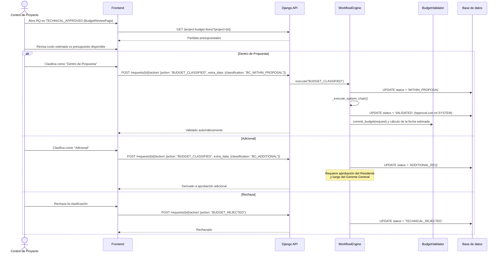

| Campo | Detalle |
|-------|---------|
| **ID** | CU-04 |
| **Nombre** | Clasificación Presupuestal |
| **Actor principal** | Control de Proyecto (PROJECT_CONTROL) |
| **Precondición** | RQ en estado TECHNICAL_APPROVED |
| **Flujo principal** | 1. Revisa el costo contra la partida presupuestal<br>2. `BUDGET_CLASSIFIED` con `BC_WITHIN_PROPOSAL`: WITHIN_PROPOSAL → VALIDATED (automático)<br>3. `BUDGET_CLASSIFIED` con `BC_ADDITIONAL`: ADDITIONAL_REQ → requiere `TECHNICAL_APPROVED` del Residente y luego aprobación del Gerente General |
| **Postcondición** | RQ validado o derivado a aprobación de gerencia |
| **Efectos al validar** | Al llegar a VALIDATED el motor calcula `fecha_estimada_entrega` (SLA según el tipo de adquisición) y compromete el costo estimado en la partida vinculada al RQ (`BudgetValidator.commit_budget`; no hace nada si el RQ no tiene partida). Si el compromiso falla, se registra una advertencia y la transición continúa |

---

#### CU-05: Validación Administrativa (Flujo Administrativo)

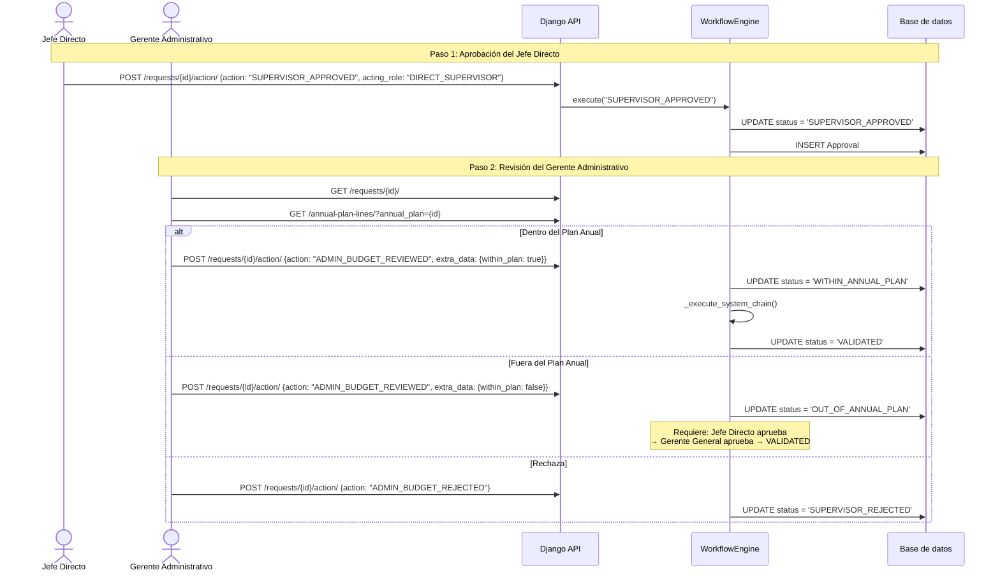

| Campo | Detalle |
|-------|---------|
| **ID** | CU-05 |
| **Nombre** | Validación Administrativa |
| **Actores** | Jefe Directo (DIRECT_SUPERVISOR) y Gerente Administrativo (ADMIN_MANAGER) |
| **Precondición** | RQ en estado SUBMITTED, flujo ADMINISTRATIVE |
| **Flujo principal** | 1. El Jefe Directo aprueba (`SUPERVISOR_APPROVED`) o rechaza (`SUPERVISOR_REJECTED`)<br>2. El Gerente Administrativo revisa el presupuesto contra el Plan Anual (`ADMIN_BUDGET_REVIEWED`) o rechaza (`ADMIN_BUDGET_REJECTED`)<br>3. Dentro del plan → VALIDATED (automático); fuera del plan → el Jefe Directo evalúa la necesidad y, si aprueba, pasa a GM_REVIEW |
| **Postcondición** | RQ validado, en revisión de gerencia o rechazado |

---

#### CU-06: Aprobación de Gerencia General

| Campo | Detalle |
|-------|---------|
| **ID** | CU-06 |
| **Nombre** | Aprobación de Gerencia General |
| **Actor principal** | Gerente General (GENERAL_MANAGER) |
| **Precondición** | RQ en estado GM_REVIEW (adicional al presupuesto o fuera del plan anual) |
| **Flujo principal** | 1. Ve la lista de RQ pendientes de aprobación (ManagerApprovalPage)<br>2. Revisa justificación y montos<br>3. Aprueba (`GM_APPROVED`) → GM_APPROVED → VALIDATED (automático)<br>4. O rechaza (`GM_REJECTED`) → GM_REJECTED |
| **Postcondición** | RQ aprobado por gerencia o rechazado definitivamente |

---

#### CU-07 a CU-09: Logística y Compras

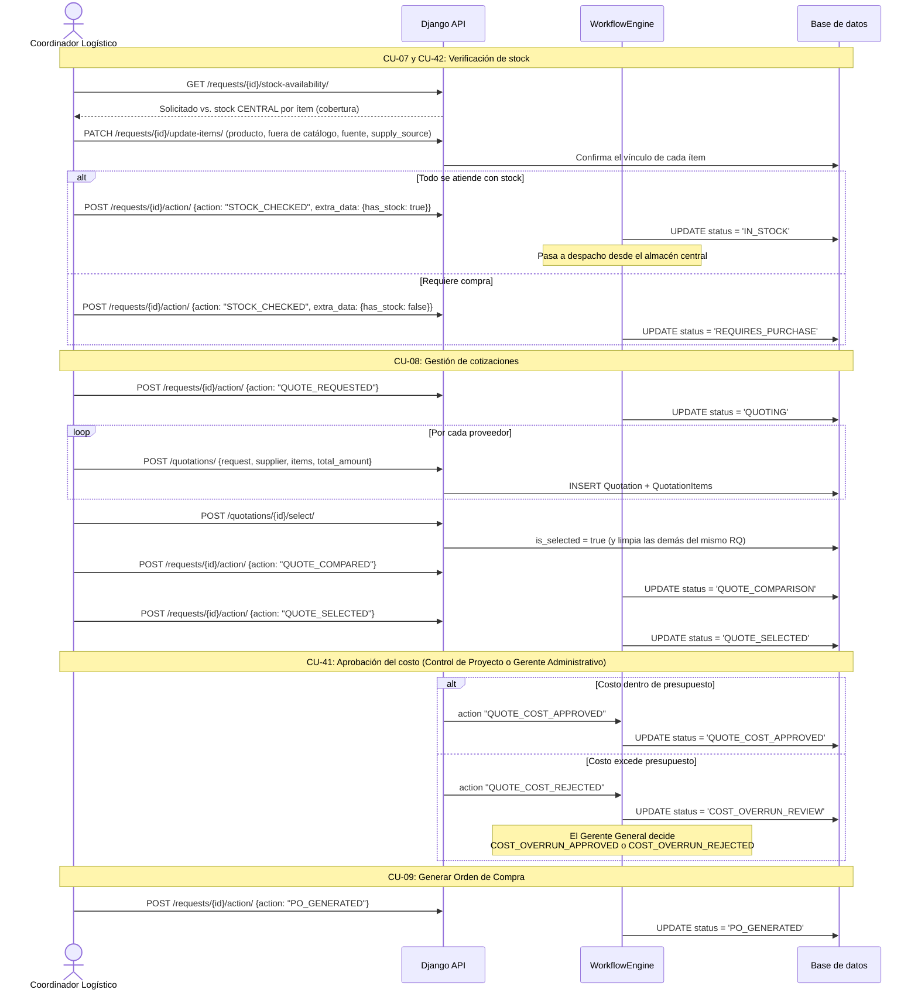

**Observaciones sobre la Orden de Compra.** La acción `PO_GENERATED` solo registra la transición del flujo; la pantalla de logística no crea el registro formal de OC. El endpoint `POST /purchase-orders/` existe (numera `OC-YYYY-NNNN` con `PONumberGenerator` y exige un rol de logística), pero el SPA actual no lo invoca. La verificación de stock del flujo Administrativo la hace el Supervisor Logístico (`LOGISTICS_SUPERVISOR`) y la comparación y selección de cotizaciones el Jefe Logístico (`LOGISTICS_CHIEF`); en Operaciones todo lo realiza el Coordinador Logístico. La aprobación del costo la da Control de Proyecto (Operaciones) o el Gerente Administrativo (Administrativo).

---

#### CU-10 y CU-11: Recepción y Entrega

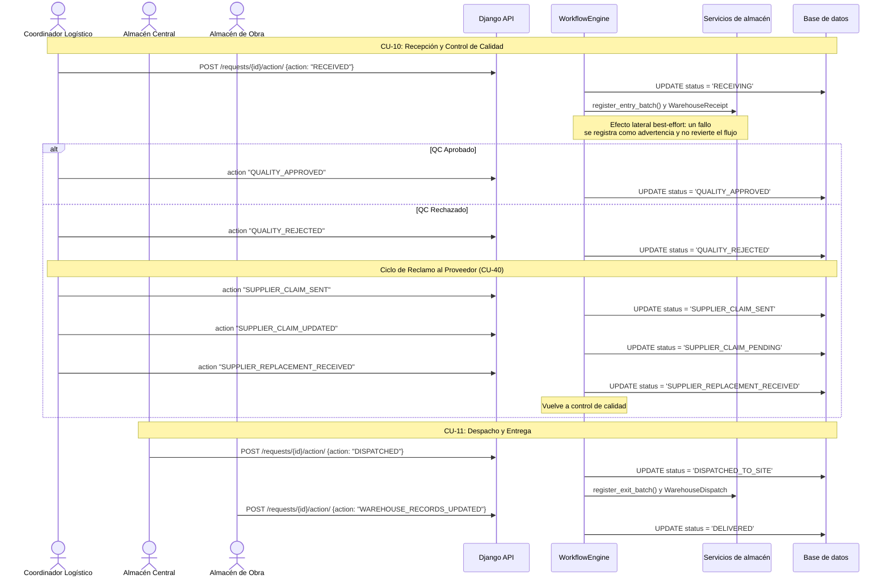

**Diferencias del flujo Administrativo.** El despacho desde stock (`IN_STOCK`) lo hace el Almacén Central y lleva el RQ directo a DELIVERED; después de `QUALITY_APPROVED` despacha el Supervisor Logístico; el paso `DISPATCHED_TO_SITE → DELIVERED` lo hace el Almacén Central; y `DELIVERED → WAREHOUSE_UPDATED` (acción `WAREHOUSE_RECORDS_UPDATED`, Almacén Central) antecede a la conformidad del usuario. Los estados, roles y transiciones están definidos por gerencia en el workflow y no se modifican.

---

#### CU-12 y CU-13: Conformidad y Cierre

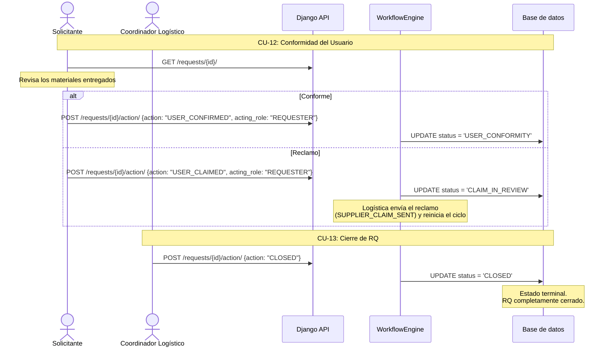

En el flujo Administrativo la conformidad parte de `WAREHOUSE_UPDATED`, y el cierre lo hace el Supervisor Logístico.

---

#### CU-14: Cancelar RQ

| Campo | Detalle |
|-------|---------|
| **ID** | CU-14 |
| **Nombre** | Cancelar Requerimiento |
| **Actor principal** | Usuario con acceso al RQ y un rol asignado |
| **Precondición** | RQ en cualquier estado no terminal |
| **Flujo principal** | 1. Ejecuta la acción `CANCELLED` en `POST /requests/{id}/action/`<br>2. El motor pasa el RQ a CANCELLED e intenta liberar el presupuesto comprometido en la partida vinculada (si la tiene) |
| **Observaciones** | La tabla de transiciones define `CANCELLED` con `required_role = None`: el motor no exige un rol concreto, solo que el usuario posea el `acting_role` declarado y que el RQ esté dentro de su alcance de visibilidad |

---

#### CU-40: Reclamo a Proveedor

| Campo | Detalle |
|-------|---------|
| **ID** | CU-40 |
| **Nombre** | Reclamo a Proveedor |
| **Actores** | Coordinador Logístico (Operaciones) o Supervisor Logístico (Administrativo) |
| **Precondición** | RQ en QUALITY_REJECTED, o en CLAIM_IN_REVIEW tras un reclamo del solicitante |
| **Flujo principal** | 1. `SUPPLIER_CLAIM_SENT` → SUPPLIER_CLAIM_SENT<br>2. (Operaciones) `SUPPLIER_CLAIM_UPDATED` → SUPPLIER_CLAIM_PENDING<br>3. `SUPPLIER_REPLACEMENT_RECEIVED` → SUPPLIER_REPLACEMENT_RECEIVED (también directo desde el paso 1)<br>4. Nuevo control de calidad: `QUALITY_APPROVED` o `QUALITY_REJECTED` |
| **Observaciones** | El ciclo se registra con las acciones del flujo. El modelo `Claim` y el endpoint `/claims/` existen, pero ni el SPA ni el motor crean registros `Claim` hoy |

---

#### CU-41: Aprobar Costo de la Cotización o Sobrecosto

| Campo | Detalle |
|-------|---------|
| **ID** | CU-41 |
| **Nombre** | Aprobar costo de la cotización / sobrecosto |
| **Actores** | Control de Proyecto (Operaciones), Gerente Administrativo (Administrativo) y Gerente General (sobrecosto) |
| **Precondición** | RQ en QUOTE_SELECTED (costo) o COST_OVERRUN_REVIEW (sobrecosto) |
| **Flujo principal** | 1. Control de Proyecto o Gerente Administrativo ejecuta `QUOTE_COST_APPROVED` (→ QUOTE_COST_APPROVED) o `QUOTE_COST_REJECTED` (→ COST_OVERRUN_REVIEW)<br>2. El Gerente General ejecuta `COST_OVERRUN_APPROVED` (→ COST_OVERRUN_APPROVED, luego OC) o `COST_OVERRUN_REJECTED` (→ COST_OVERRUN_REJECTED, estado final) |
| **Pantallas** | QuoteCostReviewPage y CostOverrunReviewPage |

---

#### CU-42: Vincular Ítems al Catálogo y Revisar Disponibilidad

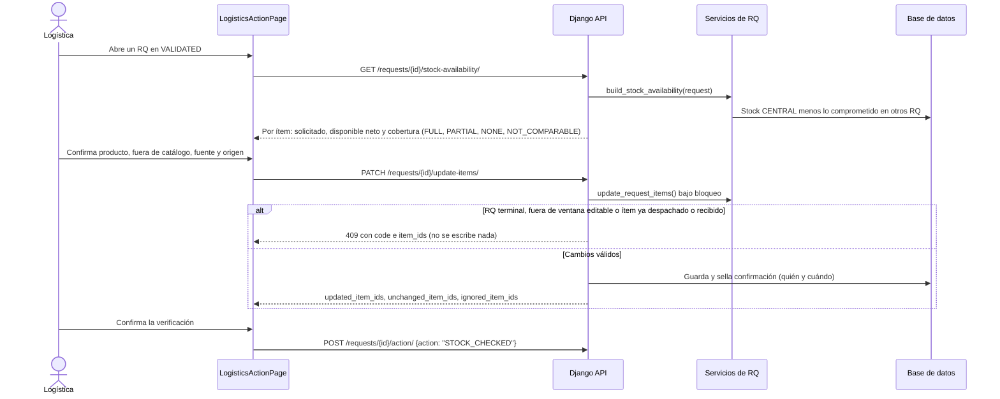

| Campo | Detalle |
|-------|---------|
| **ID** | CU-42 |
| **Nombre** | Vincular ítems al catálogo y revisar disponibilidad |
| **Actores** | Coordinador, Supervisor o Jefe Logístico |
| **Precondición** | RQ validado (la ventana editable va desde VALIDATED hasta antes del despacho) |
| **Reglas de negocio** | - Un ítem se vincula a un producto del catálogo **o** se marca fuera de catálogo; nunca ambos<br>- La disponibilidad es informativa y mira el pool CENTRAL; si las unidades difieren, la cobertura es NOT_COMPARABLE (no hay conversión)<br>- La confirmación de Logística es la que cuenta para mover stock; un producto propuesto por el solicitante no basta<br>- Un ítem marcado fuera de catálogo nunca mueve stock |

---

## 3. Casos de Uso — Módulo de Almacén

### 3.1 Diagrama de Casos de Uso

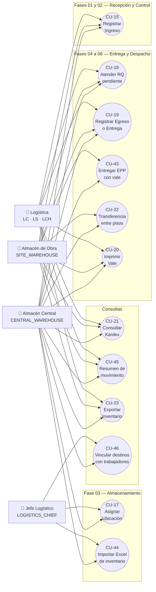

> **Notas.** CU-16 (inspección y validación) quedó absorbido por CU-15 y por el control de calidad del RQ (CU-10). Los roles de almacén de obra solo operan el almacén `SITE`; las entregas a trabajadores o a otro piso (CU-43 y CU-22) son exclusivas del Almacén Central y el Almacén de Obra. Ningún permiso del módulo concede acceso por ser superusuario.

### 3.2 Secuencia: Registrar Ingreso de Mercadería (CU-15)

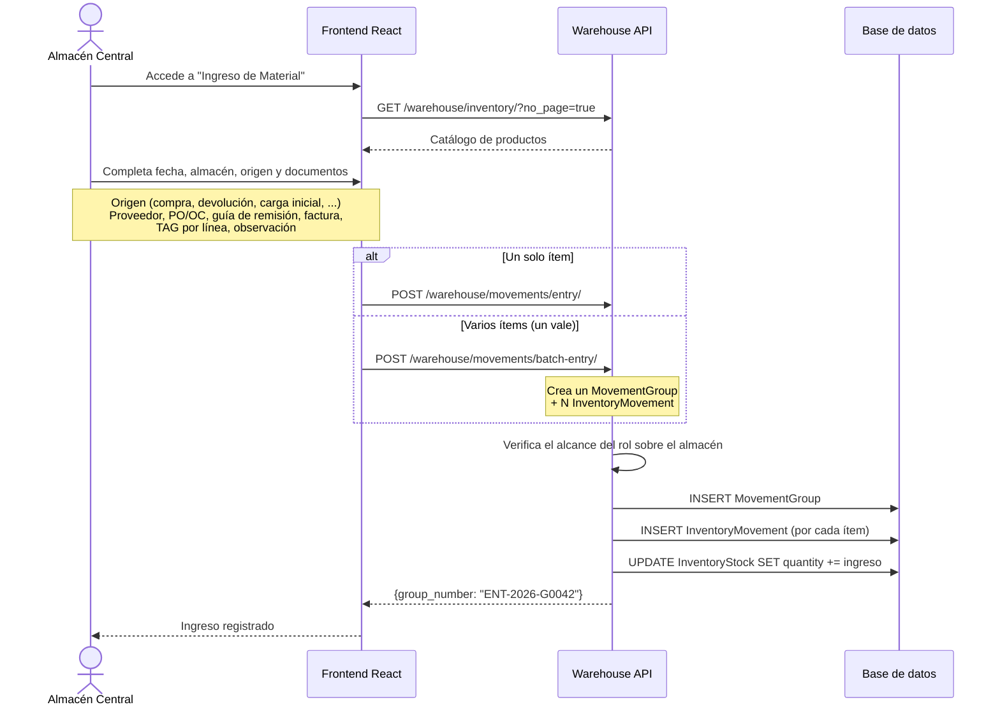

El número de movimiento sigue el formato `ENT-AAAA-NNNN` y el del grupo (vale interno) `ENT-AAAA-GNNNN`. Los ingresos de RQ por compra se registran solos cuando el flujo ejecuta la acción `RECEIVED`.

### 3.3 Secuencia: Registrar Egreso y Entrega con Vale (CU-19 y CU-43)

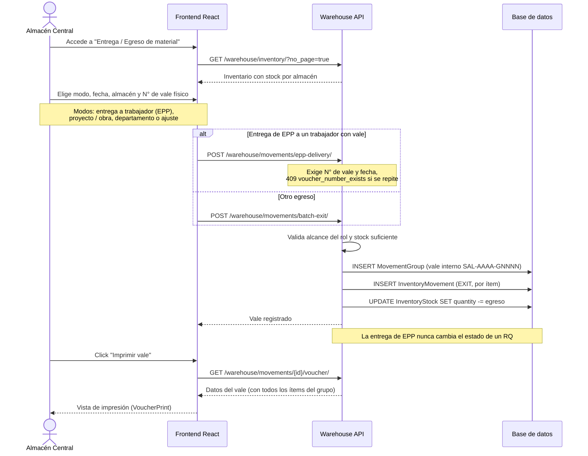

El PDF del vale puede generarse con `GET /warehouse/movements/groups/{id}/pdf/`; si hay una cuenta de OneDrive conectada, una tarea de Celery sube el PDF y guarda el enlace.

### 3.4 Secuencia: Consultar Kardex y Resumen de Movimiento (CU-21 y CU-45)

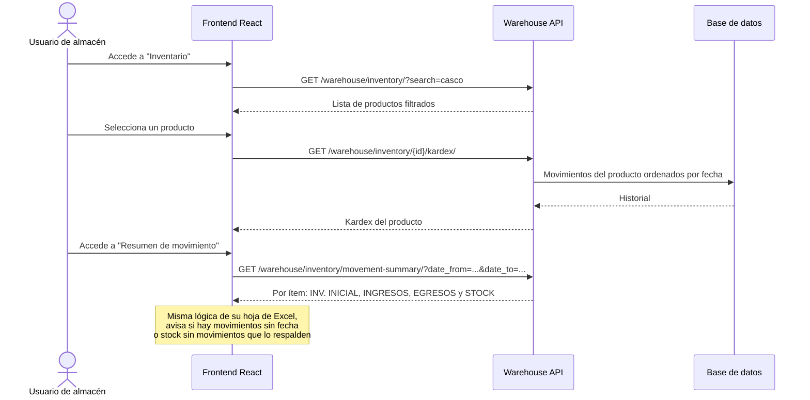

### 3.5 Importar el Libro de Inventario (CU-44)

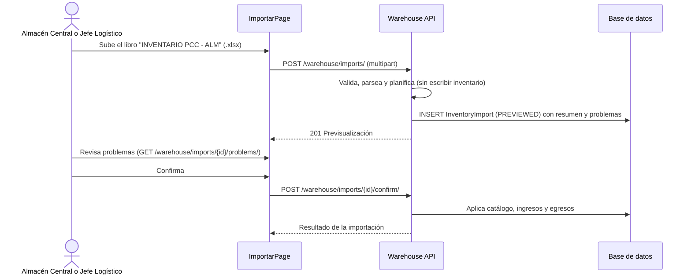

| Campo | Detalle |
|-------|---------|
| **ID** | CU-44 |
| **Actores** | Almacén Central y Jefe Logístico (los cinco roles de almacén leen el historial) |
| **Reglas de negocio** | - Dos pasos: previsualizar y confirmar<br>- Una previsualización vence y una importación terminada borra el libro guardado (puede tener nombres de trabajadores); una tarea diaria lo hace<br>- El mismo archivo confirmado en el mismo almacén no se vuelve a aplicar<br>- Límite de importaciones por hora por usuario |

---

## 4. Casos de Uso — Módulo de Administración (Pasajes)

### 4.1 Diagrama de Casos de Uso

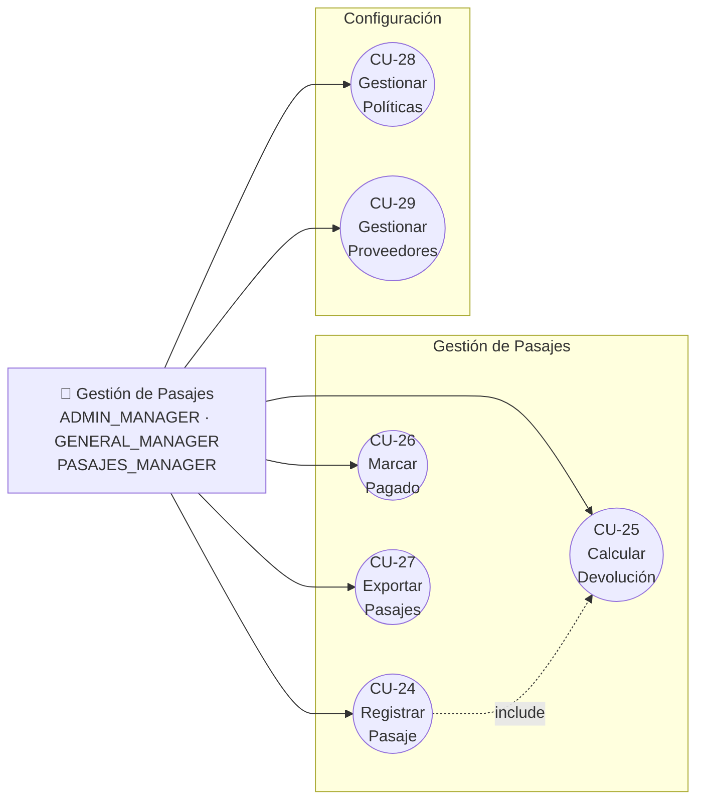

### 4.2 Secuencia: Registrar Pasaje (CU-24)

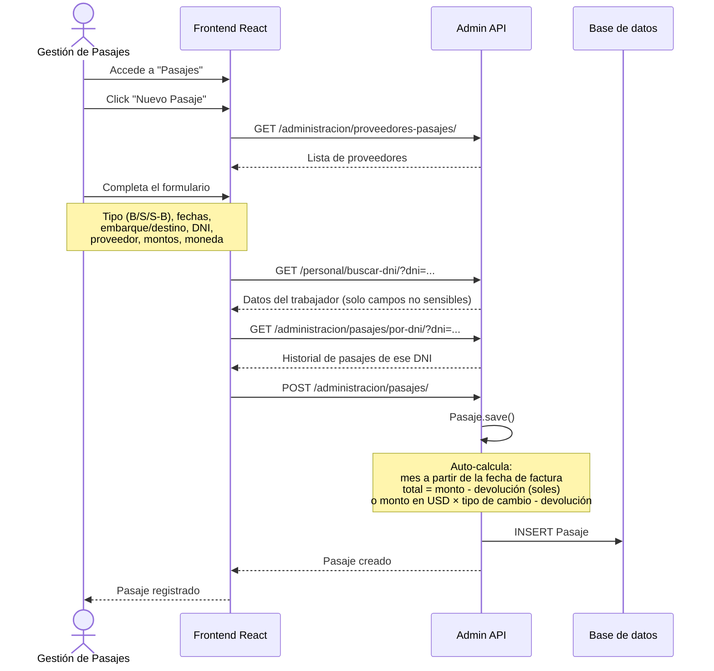

El módulo exige el rol `ADMIN_MANAGER`, `GENERAL_MANAGER` o `PASAJES_MANAGER` (o usuario staff). El tipo de cambio del día se consulta a un servicio externo y se guarda en caché por 4 horas.

---

## 5. Casos de Uso — Módulo de Soporte TI

### 5.1 Diagrama de Casos de Uso

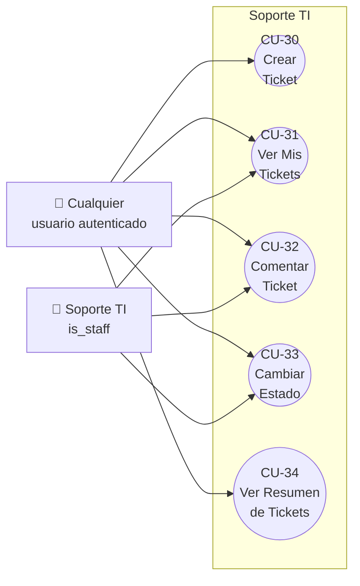

Un usuario común solo ve y gestiona sus propios tickets; un usuario staff ve todos los tickets. El resumen de CU-34 (`my-stats`) cuenta los tickets propios por estado.

### 5.2 Secuencia: Crear y Gestionar Ticket (CU-30)

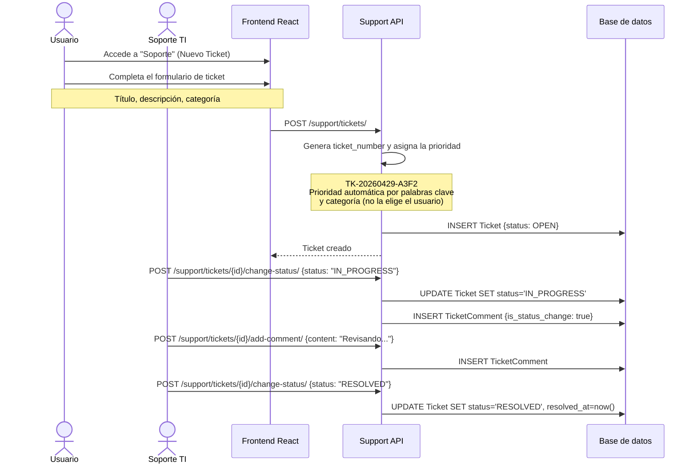

No se pueden agregar comentarios a un ticket cerrado. La asignación (`assigned_to`) se administra desde el panel de Django.

---

## 6. Casos de Uso — Recursos Humanos, Sistema, Autenticación y Configuración

### 6.1 Diagrama de Casos de Uso

```mermaid
graph LR
    HRM[👤 Gestor de RR. HH.<br/>HR_MANAGER]
    GM[👤 Gerente General<br/>solo lectura]
    SU[👤 Superadministrador<br/>is_superuser]
    USR[👤 Usuario]

    subgraph "RR. HH. (/rrhh)"
        CU47((CU-47<br/>Gestionar<br/>Plantillas))
        CU48((CU-48<br/>Generar y<br/>Emitir Contrato))
        CU49((CU-49<br/>Analizar CVs<br/>en lote))
    end

    subgraph "Administración del Sistema (/sistema)"
        CU50((CU-50<br/>Gestionar Usuarios<br/>y Roles))
        CU51((CU-51<br/>Gestionar<br/>Proyectos))
    end

    subgraph "Autenticación y Configuración"
        CU35((CU-35<br/>Iniciar<br/>Sesión))
        CU36((CU-36<br/>Cerrar<br/>Sesión))
        CU37((CU-37<br/>Seleccionar<br/>Módulo))
        CU38((CU-38<br/>Cambiar<br/>Contraseña))
        CU39((CU-39<br/>Gestionar<br/>Firma))
        CU52((CU-52<br/>Elegir tema<br/>claro u oscuro))
    end

    HRM --> CU47
    HRM --> CU48
    HRM --> CU49
    GM -.-> CU48
    GM -.-> CU49
    SU --> CU50
    SU --> CU51
    USR --> CU35
    USR --> CU36
    USR --> CU37
    USR --> CU38
    USR --> CU39
    USR --> CU52
```

### 6.2 Secuencia: Generar y Emitir un Contrato (CU-48)

```mermaid
sequenceDiagram
    actor HRM as Gestor de RR. HH.
    participant UI as Frontend React
    participant API as HR API
    participant AI as Asistente de IA (API de Anthropic)
    participant DB as Base de datos

    HRM->>UI: Click "Nuevo contrato"
    opt Asistente disponible
        HRM->>UI: Describe el pedido en texto libre
        UI->>API: POST /hr/assistant/extract/
        API->>AI: Extrae datos estructurados (no redacta el contrato)
        AI-->>API: Campos y preguntas por lo que falta
        API-->>UI: Datos propuestos
    end
    HRM->>UI: Elige trabajador y plantilla activa
    UI->>API: GET /hr/personal/{id}/prefill/
    API-->>UI: Datos precargados desde Personal
    UI->>API: POST /hr/documents/ {template_id, personal_id, data}
    API->>DB: INSERT GeneratedDocument (DRAFT)
    HRM->>UI: Revisa y emite
    UI->>API: POST /hr/documents/{id}/issue/
    API->>DB: Asigna número y congela el documento (ISSUED)
    UI->>API: GET /hr/documents/{id}/download/?format=docx|pdf
    API-->>UI: Archivo Word o PDF
```

| Campo | Detalle |
|-------|---------|
| **ID** | CU-48 |
| **Actor principal** | Gestor de RR. HH. (el Gerente General solo lee) |
| **Reglas de negocio** | - Sin `ANTHROPIC_API_KEY` el módulo funciona en modo formulario<br>- Un documento emitido no se edita; se anula con motivo<br>- Los archivos se guardan en almacenamiento privado fuera de `MEDIA_ROOT` y toda respuesta de `/api/v1/hr/*` lleva `Cache-Control: no-store`<br>- La conversión a PDF requiere LibreOffice en el servidor |

### 6.3 Secuencia: Analizar CVs en Lote (CU-49)

```mermaid
sequenceDiagram
    actor HRM as Gestor de RR. HH.
    participant UI as Wizard de CVs
    participant API as HR API
    participant Q as Cola hr_cv (Celery)
    participant AI as Agente de IA (API de Anthropic)

    HRM->>UI: Crea el análisis y, opcionalmente, sube la convocatoria
    UI->>API: POST /hr/cv-analyses/ y POST .../posting/extract/
    HRM->>UI: Sube PDF, Word o imágenes
    UI->>API: POST /hr/cv-analyses/{id}/items/ (por archivo)
    API->>Q: Un CV = una tarea (hr.process_cv_item)
    loop Mientras haya CVs en proceso
        UI->>API: GET /hr/cv-analyses/{id}/progress/?since=...
    end
    Q->>AI: Lee el CV y genera el reporte
    HRM->>UI: Revisa ranking y reportes
    UI->>API: GET .../download-zip/ o .../download-xlsx/
```

El análisis de CVs es una sugerencia (avanzar, revisar, no avanzar); la decisión es humana. Una tarea programada reencola los CVs atascados cada 5 minutos.

### 6.4 Secuencia: Iniciar Sesión (CU-35)

```mermaid
sequenceDiagram
    actor USR as Usuario
    participant UI as LoginPage
    participant AX as Axios Client
    participant API as Django Auth
    participant JWT as SimpleJWT
    participant DB as Base de datos

    UI->>AX: GET /auth/csrf/ (al abrir la aplicación)
    AX->>API: Solicita la cookie csrftoken
    API-->>AX: Set-Cookie: csrftoken (legible por JS)

    USR->>UI: Ingresa usuario y contraseña
    UI->>AX: POST /auth/login/ {username, password} + X-CSRFToken

    AX->>API: Request con credenciales
    API->>API: Límites de intentos por IP y por usuario
    API->>JWT: CustomTokenObtainPairView
    JWT->>DB: Validar credenciales
    DB-->>JWT: Usuario válido

    JWT->>JWT: Generar tokens
    Note over JWT: access_token (15 min)<br/>refresh_token (1 día)

    JWT-->>API: Tokens generados
    API-->>AX: Respuesta con el perfil + Set-Cookie
    Note over API: Set-Cookie: access_token y refresh_token<br/>(HttpOnly, SameSite=Lax, Path=/,<br/>Secure cuando DEBUG es falso)

    UI->>AX: GET /users/me/
    AX->>API: Request (cookie enviada automáticamente)
    API->>API: CookieJWTAuthentication lee la cookie
    API->>DB: SELECT User + UserRoles
    API-->>UI: {username, roles, is_superuser, must_change_password, ...}

    UI->>UI: AuthContext.setCurrentUser(user)
    alt must_change_password
        UI-->>USR: Redirige a /cambiar-password (bloqueo hasta cambiarla)
    else
        UI-->>USR: Redirige a SystemSelectPage
        USR->>UI: Selecciona un módulo según sus roles
        Note over USR,UI: RQ (/rq) · Almacén (/almacen) · Soporte (/soporte)<br/>RR. HH. (/rrhh) · Administración (/admin)<br/>Administración del Sistema (/sistema, solo superusuario)
    end
```

Mientras `must_change_password` esté activo, el backend rechaza toda petición fuera de una lista corta (perfil propio, cambio de contraseña, cierre de sesión, cookie CSRF y renovación del token).

### 6.5 Secuencia: Renovación del Token en el Cliente

```mermaid
sequenceDiagram
    participant UI as Componente React
    participant AX as Axios Interceptor
    participant API as Django Auth

    UI->>AX: GET /requests/ (access_token expirado)
    AX->>API: Request
    API-->>AX: 401 Unauthorized

    AX->>AX: Interceptor detecta 401
    AX->>AX: isRefreshing = true
    AX->>AX: Encola las peticiones pendientes

    AX->>API: POST /auth/token/refresh/ (cuerpo vacío + X-CSRFToken)
    Note over AX,API: La vista es el TokenRefreshView estándar de SimpleJWT,<br/>que espera "refresh" en el cuerpo y no lo lee de la cookie

    alt Renovación exitosa
        API-->>AX: Tokens nuevos
        AX->>AX: Reintenta las peticiones encoladas
    else Falla
        API-->>AX: Error
        AX-->>UI: Rechaza las peticiones encoladas
    end
```

**Brecha conocida.** El cliente invoca la renovación sin cuerpo porque el refresh token vive en una cookie `httpOnly`, mientras que la vista de SimpleJWT lee `refresh` del cuerpo. El propio código de pruebas (`apps/core/tests/test_must_change_password_gate.py`) la reconoce como una brecha preexistente fuera del alcance de SYSPCC-018. El cierre de sesión sí lee la cookie y la invalida.

### 6.6 Configuración: Tema Claro, Oscuro o Automático (CU-52)

El usuario alterna claro/oscuro con el botón del encabezado, o elige el modo (claro, oscuro, automático) y el rango horario del modo automático en `/settings` → Apariencia. El modo automático usa por defecto 19:00 a 07:00. La preferencia se guarda en el `localStorage` del navegador (clave `syspcc.theme.v1`), no en el servidor; si el navegador no permite guardarla, el tema se aplica igual durante la sesión.

---

## 7. Matriz de Casos de Uso por Actor

Leyenda: ✓ = puede ejecutarlo; L = solo lectura; (a) = solo en el almacén de obra; (b) = con restricciones descritas en el caso de uso.

| Caso de Uso | REQ | PR | PC | GM | LC | LS | LCH | CW | SW | DS | AM | PJ | HRM | SU |
|-------------|:---:|:--:|:--:|:--:|:--:|:--:|:---:|:--:|:--:|:--:|:--:|:--:|:---:|:--:|
| CU-01 Crear RQ (b) | ✓ | | | | | | | | | | | | | |
| CU-02 Enviar RQ | ✓ | | | | | | | | | | | | | |
| CU-03 Validación Técnica | | ✓ | | | | | | | | | | | | |
| CU-04 Clasificación Presupuestal | | | ✓ | | | | | | | | | | | |
| CU-05 Validación Administrativa | | | | | | | | | | ✓ | ✓ | | | |
| CU-06 Aprobación GG | | | | ✓ | | | | | | | | | | |
| CU-07 Verificar Stock | | | | | ✓ | ✓ | | | | | | | | |
| CU-08 Gestionar Cotizaciones | | | | | ✓ | ✓ | ✓ | | | | | | | |
| CU-09 Generar OC | | | | | ✓ | ✓ | | | | | | | | |
| CU-10 Recepción y QC | | | | | ✓ | ✓ | | | | | | | | |
| CU-11 Despacho y Entrega | | | | | ✓ | ✓ | | ✓ | ✓ | | | | | |
| CU-12 Conformidad | ✓ | | | | | | | | | | | | | |
| CU-13 Cierre de RQ | | | | | ✓ | ✓ | | | | | | | | |
| CU-14 Cancelar RQ (b) | ✓ | ✓ | ✓ | ✓ | ✓ | ✓ | ✓ | ✓ | ✓ | ✓ | ✓ | | | |
| CU-15 Registrar Ingreso | | | | | ✓ | ✓ | ✓ | ✓ | (a) | | | | | |
| CU-17 Asignar Ubicación | | | | | | | ✓ | ✓ | | | | | | |
| CU-18 Atender RQ pendiente | | | | | ✓ | ✓ | ✓ | ✓ | ✓ | | | | | |
| CU-19 Egreso o Entrega (b) | | | | | ✓ | ✓ | ✓ | ✓ | (a) | | | | | |
| CU-20 Imprimir Vale | | | | | ✓ | ✓ | ✓ | ✓ | ✓ | | | | | |
| CU-21 Consultar Kardex | | | | | ✓ | ✓ | ✓ | ✓ | ✓ | | | | | |
| CU-22 Transferencia entre pisos | | | | | | | | ✓ | ✓ | | | | | |
| CU-23 Exportar Inventario | | | | | ✓ | ✓ | ✓ | ✓ | ✓ | | | | | |
| CU-24 a CU-29 Pasajes y configuración | | | | ✓ | | | | | | | ✓ | ✓ | | |
| CU-30 Crear Ticket | ✓ | ✓ | ✓ | ✓ | ✓ | ✓ | ✓ | ✓ | ✓ | ✓ | ✓ | ✓ | ✓ | ✓ |
| CU-35 Iniciar Sesión | ✓ | ✓ | ✓ | ✓ | ✓ | ✓ | ✓ | ✓ | ✓ | ✓ | ✓ | ✓ | ✓ | ✓ |
| CU-40 Reclamo a Proveedor | | | | | ✓ | ✓ | | | | | | | | |
| CU-41 Aprobar costo o sobrecosto | | | ✓ | ✓ | | | | | | | ✓ | | | |
| CU-42 Vincular ítems y disponibilidad | | | | | ✓ | ✓ | ✓ | | | | | | | |
| CU-43 Entregar EPP con vale | | | | | | | | ✓ | ✓ | | | | | |
| CU-44 Importar Excel de inventario | | | | | | | ✓ | ✓ | | | | | | |
| CU-45 Resumen de movimiento | | | | | ✓ | ✓ | ✓ | ✓ | ✓ | | | | | |
| CU-46 Vincular destinos con trabajadores | | | | | | | ✓ | ✓ | | | | | | |
| CU-47 a CU-49 RR. HH. | | | | L | | | | | | | | | ✓ | |
| CU-50 y CU-51 Sistema | | | | | | | | | | | | | | ✓ |
| CU-52 Elegir tema | ✓ | ✓ | ✓ | ✓ | ✓ | ✓ | ✓ | ✓ | ✓ | ✓ | ✓ | ✓ | ✓ | ✓ |

Notas de la matriz:

- **(b) CU-01.** El backend permite crear RQ a cualquier usuario autenticado; la conformidad (CU-12) exige el rol `REQUESTER`.
- **(b) CU-14.** La tabla de transiciones no exige un rol específico para `CANCELLED`; cualquier usuario con un rol asignado y acceso al RQ puede ejecutarla.
- **(b) CU-19.** Las salidas hacia un trabajador o a otro piso las hacen solo Almacén Central y Almacén de Obra; el resto de salidas pueden hacerlas también los roles de logística.
- **Soporte.** Los usuarios staff ven y gestionan todos los tickets; los demás, solo los suyos.
- **Superusuario.** Gestiona usuarios y proyectos en `/sistema`; los permisos del almacén no le conceden acceso adicional.

---

*Documento de casos de uso de SYSPCC — PCC Ingeniería y Construcción*
*Última actualización: Octubre 2026 (código al día con SYSPCC-026)*
