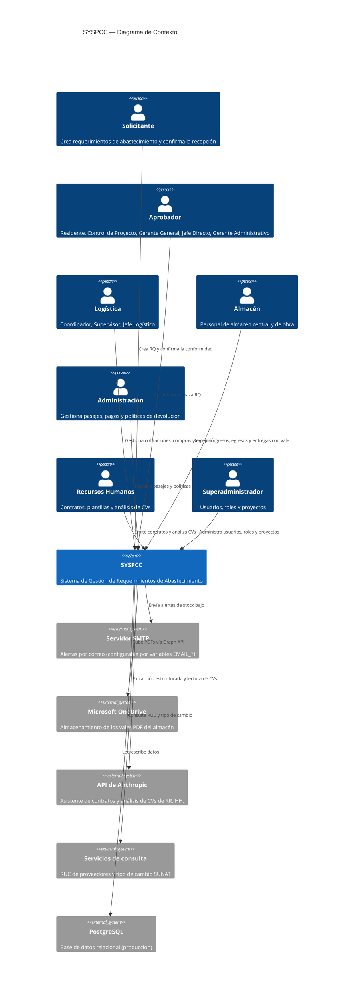
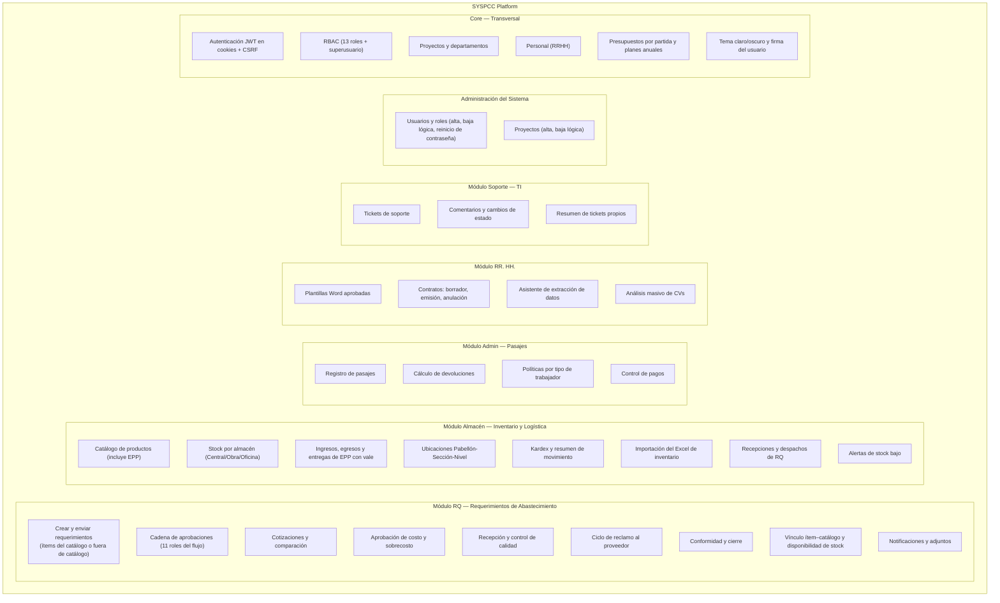
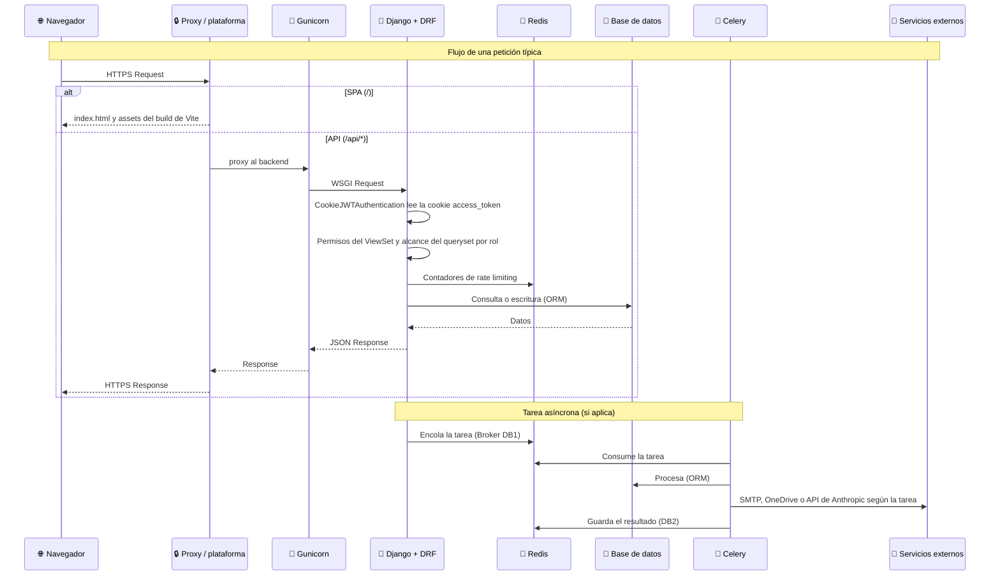
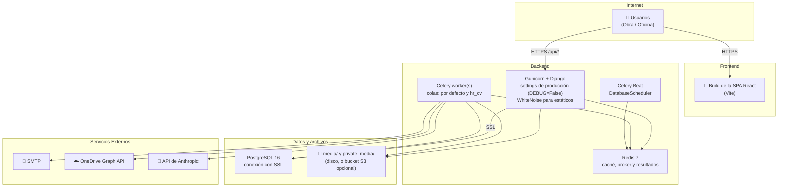
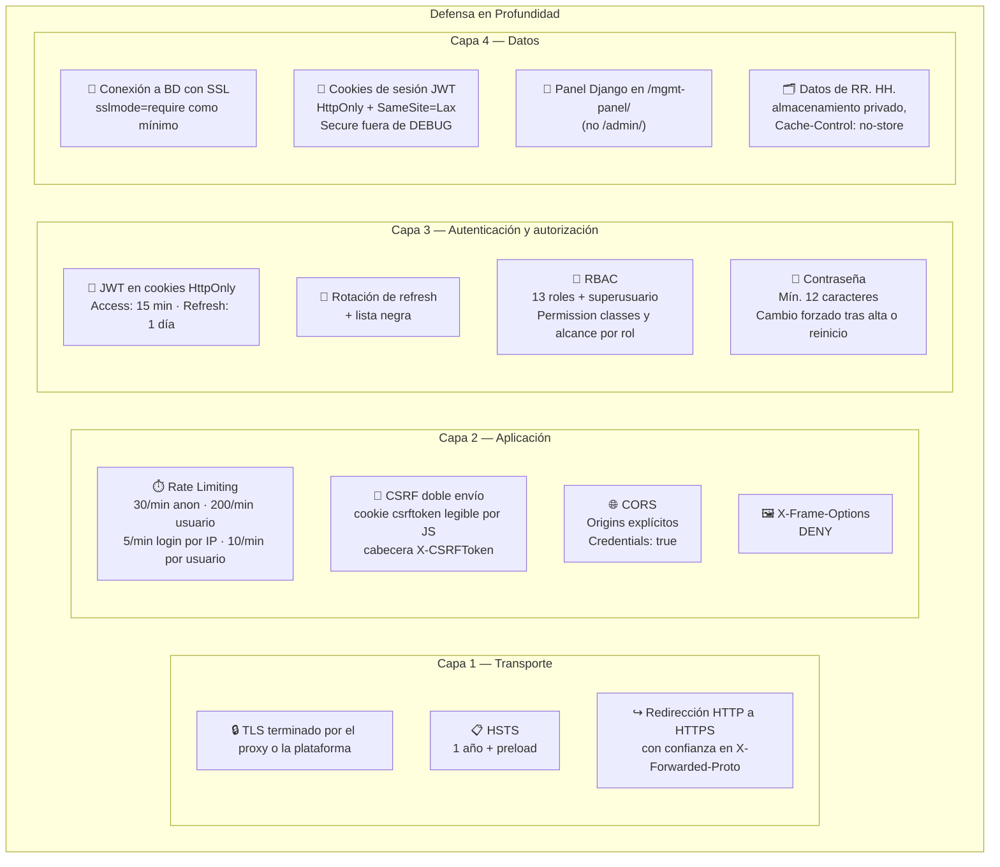
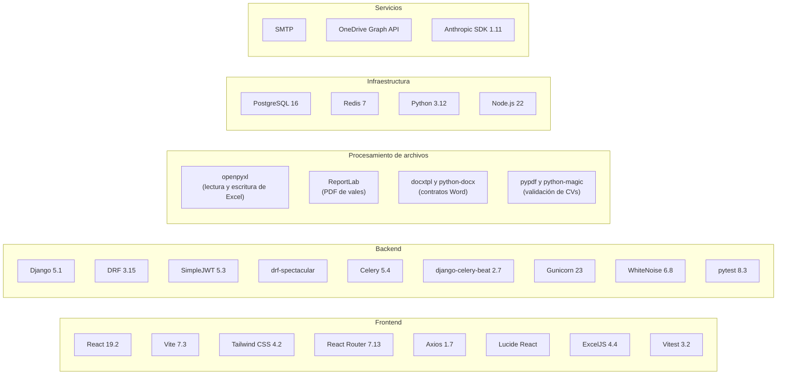
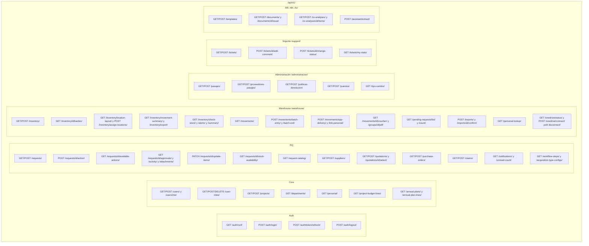

# SYSPCC — Arquitectura de Alto Nivel

**Sistema de Gestión de Requerimientos de Abastecimiento**
**Versión:** 1.1 | **Fecha:** Octubre 2026 | **Empresa:** PCC Ingeniería y Construcción

---

## 1. Vista General del Sistema

---

## 2. Arquitectura de Capas

```mermaid
graph TB
    subgraph "CAPA DE PRESENTACIÓN"
        direction LR
        BROWSER["🌐 Navegador Web<br/>(Chrome, Edge, Firefox)"]
    end

    subgraph "CAPA DE FRONTEND"
        direction LR
        SPA["⚛️ React 19 SPA<br/>Vite 7.3 + Tailwind CSS 4<br/>Tema claro/oscuro"]

        subgraph "Módulos Frontend"
            direction LR
            RQ_FE["📋 RQ System<br/>/rq/*<br/>AppShell"]
            WH_FE["📦 Almacén<br/>/almacen/*<br/>WarehouseShell"]
            AD_FE["✈️ Admin<br/>/admin/*<br/>AdminShell"]
            HR_FE["👥 RR. HH.<br/>/rrhh/*<br/>HRShell"]
            SY_FE["🛡️ Sistema<br/>/sistema/*<br/>SystemAdminShell"]
            SP_FE["🎫 Soporte<br/>/soporte/*<br/>SupportShell"]
        end
    end

    subgraph "CAPA DE ENTRADA"
        PROXY["🔒 Proxy inverso o plataforma<br/>TLS y enrutado /api/*<br/>(en desarrollo: proxy de Vite)"]
    end

    subgraph "CAPA DE APLICACIÓN"
        direction LR
        GUNICORN["🦄 Gunicorn<br/>WSGI Server"]
        DJANGO["🐍 Django 5.1<br/>+ DRF 3.15"]

        subgraph "Django Apps"
            direction LR
            CORE["🔐 core<br/>Auth, Usuarios<br/>Proyectos, Deptos, Personal"]
            RQ_BE["📋 rq<br/>Requests, Aprobaciones<br/>Proveedores, Cotizaciones"]
            WH_BE["📦 warehouse<br/>Inventario, Movimientos<br/>EPP, Importación"]
            ADMIN_BE["✈️ administracion<br/>Pasajes<br/>Políticas"]
            SUPPORT_BE["🎫 support<br/>Tickets<br/>Comentarios"]
            HR_BE["👥 hr<br/>Contratos, Plantillas<br/>Análisis de CVs"]
        end

        subgraph "Servicios de Negocio"
            WF["⚙️ WorkflowEngine<br/>Máquina de estados<br/>47 estados definidos, 71 transiciones"]
            BV["💰 BudgetValidator<br/>Presupuesto y plan anual"]
            SLA["📅 SLACalculator<br/>Fecha estimada de entrega"]
            NOTIF["🔔 NotificationService<br/>Notificaciones en la app"]
            RQS["🔗 Servicios de captura<br/>Catálogo, vínculo de ítems,<br/>disponibilidad de stock"]
        end
    end

    subgraph "CAPA DE TAREAS ASÍNCRONAS"
        direction LR
        WORKER["👷 Celery Worker<br/>Tareas asíncronas<br/>(cola por defecto y hr_cv)"]
        BEAT["⏰ Celery Beat<br/>Tareas programadas"]
    end

    subgraph "CAPA DE DATOS"
        direction LR
        PG["🐘 PostgreSQL 16 (producción)<br/>SQLite (desarrollo)"]
        REDIS["🔴 Redis 7<br/>DB0: Caché y contadores<br/>DB1: Broker<br/>DB2: Resultados"]
        FILES["📁 Archivos<br/>media/ (firmas, adjuntos)<br/>private_media/ (RR. HH.)"]
    end

    subgraph "SERVICIOS EXTERNOS"
        direction LR
        SMTP["📧 Servidor SMTP"]
        ONEDRIVE["☁️ OneDrive<br/>Graph API"]
        ANTHROPIC["🤖 API de Anthropic"]
        SUNAT["🏛️ Consultas RUC<br/>y tipo de cambio"]
    end

    BROWSER -->|HTTPS| PROXY
    PROXY -->|/api/* /mgmt-panel/*| GUNICORN
    PROXY -->|/* SPA| SPA
    GUNICORN --> DJANGO
    DJANGO --> CORE
    DJANGO --> RQ_BE
    DJANGO --> WH_BE
    DJANGO --> ADMIN_BE
    DJANGO --> SUPPORT_BE
    DJANGO --> HR_BE
    RQ_BE --> WF
    RQ_BE --> BV
    RQ_BE --> SLA
    RQ_BE --> NOTIF
    RQ_BE --> RQS
    DJANGO -->|ORM| PG
    DJANGO -->|Contadores, sesiones de admin| REDIS
    DJANGO --> FILES
    WORKER -->|Consume tareas| REDIS
    BEAT -->|Programa tareas| REDIS
    WORKER -->|ORM| PG
    WORKER --> SMTP
    WORKER -->|Subida de vales PDF| ONEDRIVE
    HR_BE -->|API| ANTHROPIC
    ADMIN_BE -->|HTTP| SUNAT
    SPA -->|REST API JSON| PROXY

    RQ_FE -.-> SPA
    WH_FE -.-> SPA
    AD_FE -.-> SPA
    HR_FE -.-> SPA
    SY_FE -.-> SPA
    SP_FE -.-> SPA
```

---

## 3. Módulos del Sistema

---

## 4. Flujo de Comunicación

---

## 5. Flujos de Negocio Principales

### 5.1 Ciclo de Vida del Requerimiento (RQ)

Resumen de los dos flujos definidos por gerencia (Operaciones y Administrativo). Los estados y transiciones completos están en el documento 03, sección 5; aquí se muestra la ruta principal.

```mermaid
graph LR
    subgraph "FASE 1<br/>Solicitud"
        F1A[DRAFT] -->|SUBMITTED| F1B[SUBMITTED]
    end

    subgraph "FASE 2<br/>Validación"
        F1B -->|"aprueba el Residente (OPS)<br/>o el Jefe Directo (ADM)"| F2A["TECHNICAL_APPROVED<br/>o SUPERVISOR_APPROVED"]
        F2A -->|"clasifica el presupuesto"| F2B{¿Presupuesto?}
        F2B -->|"dentro de propuesta<br/>o del plan anual"| F2C[VALIDATED]
        F2B -->|"adicional o<br/>fuera del plan"| F2E["ADDITIONAL_REQ<br/>o OUT_OF_ANNUAL_PLAN"]
        F2E -->|"aprueba el Residente<br/>o el Jefe Directo"| F2D[GM_REVIEW]
        F2D -->|"GM_APPROVED"| F2C
    end

    subgraph "FASE 3<br/>Logística y compras"
        F2C -->|"STOCK_CHECKED"| F3A{¿Stock?}
        F3A -->|sí| F3B[IN_STOCK]
        F3A -->|no| F3C[REQUIRES_PURCHASE]
        F3C --> F3D[QUOTING]
        F3D --> F3E[QUOTE_COMPARISON]
        F3E --> F3F[QUOTE_SELECTED]
        F3F -->|"costo aprobado"| F3G[QUOTE_COST_APPROVED]
        F3F -->|"costo excede"| F3H[COST_OVERRUN_REVIEW]
        F3H -->|"aprueba el Gerente General"| F3I[COST_OVERRUN_APPROVED]
        F3G --> F3J[PO_GENERATED]
        F3I --> F3J
    end

    subgraph "FASE 4<br/>Recepción y entrega"
        F3J -->|RECEIVED| F4A[RECEIVING]
        F4A -->|QUALITY_APPROVED| F4B[QUALITY_APPROVED]
        F4A -->|QUALITY_REJECTED| F4R[QUALITY_REJECTED]
        F4R --> F4S[SUPPLIER_CLAIM_SENT]
        F4S --> F4T[SUPPLIER_REPLACEMENT_RECEIVED]
        F4T -->|"control de calidad"| F4B
        F4T -->|"control de calidad"| F4R
        F4B --> F4C[DISPATCHED_TO_SITE]
        F3B -->|"OPS: DISPATCHED"| F4C
        F4C --> F4D[DELIVERED]
        F3B -->|"ADM: despacho directo"| F4D
    end

    subgraph "FASE 5<br/>Conformidad y cierre"
        F4D -->|"USER_CONFIRMED"| F5A[USER_CONFORMITY]
        F4D -->|"USER_CLAIMED"| F5R[CLAIM_IN_REVIEW]
        F5R -->|"SUPPLIER_CLAIM_SENT"| F4S
        F5A -->|CLOSED| F5B[CLOSED]
    end
```

Notas del flujo:

- Un RQ nuevo se registra directamente en SUBMITTED; DRAFT existe como estado inicial de la máquina de estados.
- Los rechazos (`TECHNICAL_REJECTED`, `SUPERVISOR_REJECTED`, `GM_REJECTED`, `COST_OVERRUN_REJECTED`), `CLOSED` y `CANCELLED` son estados terminales.
- En el flujo Administrativo, `DELIVERED` pasa por `WAREHOUSE_UPDATED` antes de la conformidad del usuario.
- `RQStatusChoices` define 47 valores; 37 de ellos intervienen en la tabla de transiciones (diez están definidos pero no tienen transición).

### 5.2 Ciclo Operativo del Almacén

```mermaid
graph LR
    subgraph "FASE 01<br/>Recepción"
        A1["📦 Descarga de<br/>mercadería"]
        A2["📄 Validación<br/>documentaria"]
        A3["🔍 Verificación<br/>física"]
    end

    subgraph "FASE 02<br/>Control"
        B1["🔎 Inspección<br/>de calidad"]
        B2{Conformidad}
        B3["✅ Aprobado"]
        B4["❌ Rechazado"]
    end

    subgraph "FASE 03<br/>Almacenamiento"
        C1["📍 Asignación<br/>de ubicación"]
        C2["📊 Actualización<br/>de stock"]
    end

    subgraph "FASE 04<br/>Picking"
        D1["📋 Lista de<br/>picking"]
        D2["🏃 Recorrido<br/>por almacén"]
        D3["✔️ Verificación<br/>de cantidades"]
    end

    subgraph "FASE 05<br/>Packing"
        E1["📦 Selección<br/>de empaque"]
        E2["🏷️ Etiquetado"]
    end

    subgraph "FASE 06<br/>Despacho"
        F1["🚚 Carga de<br/>vehículo"]
        F2["📝 Registro<br/>de salida"]
    end

    A1 --> A2 --> A3 --> B1
    B1 --> B2
    B2 -->|conforme| B3
    B2 -->|no conforme| B4
    B3 --> C1 --> C2
    B4 -->|devolver| A1
    C2 --> D1 --> D2 --> D3
    D3 --> E1 --> E2
    E2 --> F1 --> F2
```

El ciclo lo define gerencia y no se modifica. Qué pantallas del sistema atienden cada fase hoy:

| Fase del ciclo | Pantalla o función del sistema |
|----------------|--------------------------------|
| 01 y 02 — Recepción y control | **Ingreso de Material**: fecha, almacén, origen, proveedor, PO/OC, guía de remisión, factura y TAG por línea |
| 03 — Almacenamiento | **Inventario**: asignación de la ubicación exacta (`{Pabellón}{Sección}-{Nivel}`, p. ej. B3-2) por Almacén Central o Jefe Logístico; un ítem puede tener solo el piso mientras no se conozca la ubicación. El stock se actualiza con cada movimiento |
| 04 — Picking (recepción del RQ y ubicaciones) | **RQ Pendientes** lista los RQ que esperan acción de almacén; **Inventario** muestra la ubicación de cada producto |
| 04 (paso 5) y 06 — Descuento de stock y registro de salida | **Entrega / Egreso de material** y **Entrega de EPP con vale** (N° de vale físico, trabajador, fecha); **Transferencia interna** entre pisos se registra como una salida con destino «ALM - piso» |
| Consultas | **Movimientos**, **Kardex**, **Resumen de movimiento** (INV. INICIAL, INGRESOS, EGRESOS y STOCK) y exportaciones a Excel |
| Carga inicial | **Importar Excel** del libro «INVENTARIO PCC - ALM» en dos pasos (previsualizar y confirmar) |

---

## 6. Topología de Ejecución

Esta sección describe qué procesos y servicios componen el sistema, sin entrar en el detalle de cada plataforma de despliegue (que se documenta aparte).

Entornos de configuración (`backend/config/settings/`):

| Módulo | Uso |
|--------|-----|
| `development.py` | Desarrollo local y Docker Compose: `DEBUG=True`, SQLite por defecto, CORS abierto, correo por consola |
| `production.py` | Producción: `DEBUG=False`, PostgreSQL con SSL, HSTS, cookies seguras, WhiteNoise, correo SMTP si hay credenciales |
| `demo.py` | Hereda de producción y reemplaza lo que no existe en el entorno gratuito: sin Redis (caché en memoria), Celery en modo `ALWAYS_EAGER` (sin worker ni Beat, por lo que las tareas programadas no corren) y correo por consola |

En Docker Compose local corren seis servicios: `redis`, `backend`, `frontend`, `celery_worker` (cola por defecto), `celery_worker_hr` (cola `hr_cv`) y `celery_beat`.

---

## 7. Seguridad — Vista de Alto Nivel

Nota sobre la renovación del token: la vista `/auth/token/refresh/` es la estándar de SimpleJWT y espera el refresh token en el cuerpo, mientras que el cliente lo envía vacío porque el refresh vive en una cookie `httpOnly`. La brecha está reconocida en `apps/core/tests/test_must_change_password_gate.py`.

---

## 8. Tecnologías y Versiones

---

## 9. Resumen de Endpoints API

Todos los endpoints cuelgan de `/api/v1/`. La documentación OpenAPI completa está en `/api/docs/` (requiere usuario staff).

Además existen `GET /healthz/` (verificación de salud, fuera de `/api/v1/`) y la documentación `/api/schema/`, `/api/docs/` y `/api/redoc/` (solo staff).

---

*Documento de arquitectura de alto nivel de SYSPCC — PCC Ingeniería y Construcción*
*Última actualización: Octubre 2026 (código al día con SYSPCC-026)*
