# SYSPCC — Arquitectura de Bajo Nivel

**Sistema de Gestión de Requerimientos de Abastecimiento**
**Versión:** 1.1 | **Fecha:** Octubre 2026 | **Empresa:** PCC Ingeniería y Construcción

---

## 1. Estructura de Capas del Backend

### 1.1 Flujo completo de un Request HTTP

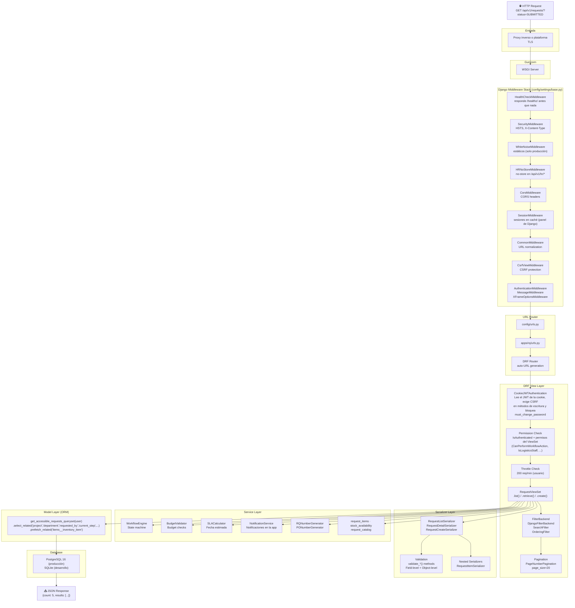

### 1.2 Responsabilidad de cada capa

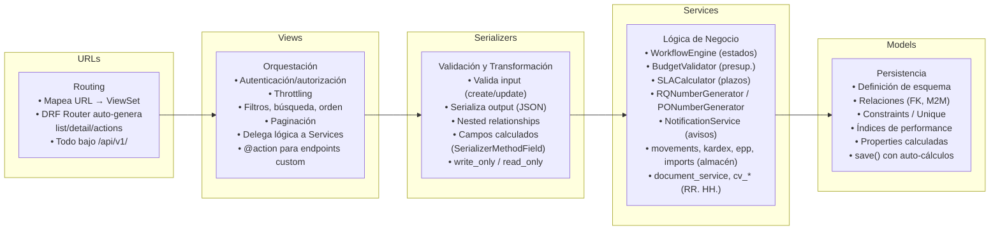

---

## 2. Estructura de Archivos del Backend

```text
backend/
├── config/
│   ├── settings/
│   │   ├── base.py              # configuración común
│   │   ├── development.py       # DEBUG, SQLite, CORS abierto
│   │   ├── production.py        # PostgreSQL con SSL, HSTS, WhiteNoise
│   │   ├── demo.py              # hereda de production (sin Redis ni worker)
│   │   └── guards.py            # validaciones de arranque (proveedor de CVs)
│   ├── urls.py                  # /api/v1/, /mgmt-panel/, /api/docs/
│   ├── urls_demo.py
│   ├── celery.py
│   ├── wsgi.py
│   └── asgi.py
├── apps/
│   ├── core/
│   │   ├── models/              # base, user, project, department, personal
│   │   ├── serializers/         # auth, user, project, department, personal
│   │   ├── views/               # auth, user, project, department, personal
│   │   ├── urls/                # auth, users, projects, departments, personal
│   │   ├── services/            # user_admin.py, signature.py
│   │   ├── utils/excel.py       # saneamiento de exportaciones a Excel
│   │   ├── authentication.py    # CookieJWTAuthentication (JWT + CSRF + cambio forzado)
│   │   ├── permissions.py
│   │   ├── throttling.py
│   │   ├── middleware.py        # /healthz/ e IP real del cliente
│   │   ├── enums.py             # roles, estados, acciones, prioridades, ...
│   │   ├── exceptions.py
│   │   ├── fields.py            # campo cifrado (tokens de OneDrive)
│   │   └── management/commands/ # seed_data, seed_demo, seed_demo_extra, seed_screenshots
│   ├── rq/
│   │   ├── models/              # request, approval, workflow, supplier, quotation,
│   │   │                        #   purchase_order, claim, attachment, notification, activity_log
│   │   ├── serializers/         # request, approval, quotation, purchase_order, supplier,
│   │   │                        #   claim, attachment, notification, activity_log, catalog, workflow
│   │   ├── views/               # request, catalog, supplier, claim, workflow
│   │   ├── services/
│   │   │   ├── workflow_engine.py      # TRANSITIONS + WorkflowEngine
│   │   │   ├── budget_validator.py
│   │   │   ├── sla_calculator.py
│   │   │   ├── number_generator.py     # RQ-AAAA-NNNN y OC-AAAA-NNNN
│   │   │   ├── notification_service.py
│   │   │   ├── request_items.py        # confirmación de vínculos (update-items)
│   │   │   ├── request_catalog.py      # búsqueda en el catálogo del almacén
│   │   │   ├── stock_availability.py   # solicitado vs. stock CENTRAL
│   │   │   ├── units.py
│   │   │   ├── link_suggestions.py     # sugerencias de vínculo (solo lectura)
│   │   │   └── stock_diagnostics.py    # diagnósticos (solo lectura)
│   │   ├── management/commands/ # check_central_project_stock, report_rq_stock_gaps,
│   │   │                        #   suggest_inventory_links
│   │   ├── tasks.py             # SLA, recordatorios, invalidación de caché
│   │   ├── cache.py
│   │   ├── filters.py
│   │   ├── permissions.py       # alcance de visibilidad y CanPerformWorkflowAction
│   │   ├── throttling.py
│   │   └── urls.py
│   ├── warehouse/
│   │   ├── models/              # inventory, movement, receipt, dispatch,
│   │   │                        #   onedrive_token, inventory_import
│   │   ├── services/            # catalog, movements, kardex, locations, epp, exports,
│   │   │                        #   onedrive, pdf_generator, personal_matching, dates,
│   │   │                        #   imports/ (parser, validators, planner, applier, ...)
│   │   ├── views.py             # inventario, movimientos, OneDrive, RQ pendientes
│   │   ├── views_imports.py     # importación del libro de inventario
│   │   ├── views_personal.py    # búsqueda de trabajadores
│   │   ├── permissions.py       # IsWarehouseRole y permisos por acción
│   │   ├── query_guard.py
│   │   ├── serializers.py
│   │   ├── serializers_imports.py
│   │   ├── tasks.py             # PDF a OneDrive, stock bajo, purga de importaciones
│   │   ├── throttling.py
│   │   └── urls.py
│   ├── administracion/         # models.py, serializers.py, services.py, views.py, urls.py
│   ├── support/                # models.py, serializers.py, services.py, views.py, urls.py
│   └── hr/
│       ├── models/             # document_template, generated_document, document_event,
│       │                       #   cv_analysis, cv_analysis_item
│       ├── documents/          # registry, contract, formatters
│       ├── services/           # document_service, template_service, docx_renderer,
│       │                       #   pdf_converter, assistant_*, cv_* (análisis de CVs)
│       ├── views/              # template, document, cv, assistant, meta, common
│       ├── serializers/
│       ├── tasks.py            # cola hr_cv
│       ├── storage.py          # almacenamiento privado
│       ├── middleware.py       # no-store
│       └── urls.py
├── requirements.txt
├── manage.py
└── Dockerfile
```

---

## 3. Estructura de Componentes del Frontend

### 3.1 Árbol de Componentes React

```mermaid
graph TB
    subgraph "App.jsx — Raíz"
        TH["ThemeProvider<br/>(ThemeContext)"]
        TP["ToastProvider<br/>(ToastContext)"]
        AP["AuthProvider<br/>(AuthContext)"]
        BR["BrowserRouter<br/>(React Router v7)"]
    end

    subgraph "Rutas públicas y de acceso"
        LOGIN["LoginPage<br/>/login"]
        CHPW["ChangePasswordRequiredPage<br/>/cambiar-password"]
        RPC["RequirePasswordChangeLayout<br/>envuelve todas las rutas autenticadas"]
        SYSSEL["SystemSelectPage<br/>/"]
    end

    subgraph "Shell RQ — /rq/*"
        APPSH["AppShell"]
        HEADER["Header (tema, notificaciones, usuario)"]
        SIDEBAR["Sidebar"]

        subgraph "Páginas RQ"
            DASH["DashboardPage"]
            RLIST["RequestListPage"]
            RCREATE["RequestCreatePage<br/>(formulario con catálogo)"]
            RDETAIL["RequestDetailPage"]
        end

        subgraph "Páginas Aprobaciones"
            APPROV["ApprovalsPage"]
            TECH["TechReviewPage<br/>(PROJECT_RESIDENT)"]
            BUDG["BudgetReviewPage<br/>(PROJECT_CONTROL, ADMIN_MANAGER)"]
            QCR["QuoteCostReviewPage<br/>(PROJECT_CONTROL, ADMIN_MANAGER)"]
            MGR["ManagerApprovalPage<br/>(GENERAL_MANAGER)"]
            COST["CostOverrunReviewPage<br/>(GENERAL_MANAGER)"]
        end

        subgraph "Páginas Operaciones"
            LOGP["LogisticsPage"]
            LOGA["LogisticsActionPage<br/>(verificación de stock, cotizaciones,<br/>recepción, reclamos y cierre)"]
        end

        REPOR["ReportsPage<br/>(GENERAL_MANAGER)"]
    end

    subgraph "Shell Almacén — /almacen/*"
        WHSH["WarehouseShell"]
        WHSB["WarehouseSidebar"]

        WHDASH["AlmacenDashboardPage"]
        INV["InventarioPage"]
        KAR["KardexPage"]
        RES["ResumenPage"]
        PEN["PendientesPage"]
        ENT["EntradaPage"]
        SAL["SalidaPage"]
        VOUCH["VoucherPrint"]
        MOV["MovimientosPage"]
        TRA["TransferenciaPage"]
        IMP["ImportarPage"]
    end

    subgraph "Shell Admin — /admin/*"
        ADMSH["AdminShell"]
        ADMSB["AdminSidebar"]

        ADMMENU["AdminMenuPage<br/>(selector, sin sidebar)"]
        ADMDASH["AdminDashboardPage"]
        PAS["PasajesPage"]
        PAG["PagosPage"]
        POL["PoliticasPage"]
        PROV["ProveedoresPage"]
    end

    subgraph "Shell RR. HH. — /rrhh/*"
        HRSH["HRShell"]
        HRSB["HRSidebar"]

        HRDL["HRDocumentsListPage"]
        HRDC["HRDocumentCreatePage"]
        HRDD["HRDocumentDetailPage"]
        HRTP["HRTemplatesPage"]
        HRCL["HRCVAnalysesListPage"]
        HRCW["HRCVWizardPage"]
        HRCA["HRCVAnalysisPage"]
    end

    subgraph "Shell Sistema — /sistema/* (solo superusuario)"
        SYSH["SystemAdminShell"]
        SYSB["SystemSidebar"]

        USRP["UsersPage"]
        USRF["UserFormPage"]
        PRJP["ProjectsPage"]
        PRJF["ProjectFormPage"]
    end

    subgraph "Shell Soporte — /soporte/*"
        SUPSH["SupportShell"]
        SUPSB["SupportSidebar"]

        SUPDASH["SupportDashboardPage"]
        TIKC["TicketCreatePage"]
        TIKL["TicketListPage"]
        TIKD["TicketDetailPage"]
    end

    SETT["SettingsPage<br/>/settings"]

    TH --> TP --> AP --> BR
    BR --> LOGIN
    BR --> CHPW
    BR --> RPC
    RPC --> SYSSEL
    RPC --> APPSH
    RPC --> WHSH
    RPC --> ADMSH
    RPC --> HRSH
    RPC --> SYSH
    RPC --> SUPSH
    RPC --> SETT

    APPSH --> HEADER
    APPSH --> SIDEBAR
    APPSH --> DASH
    APPSH --> RLIST
    APPSH --> RCREATE
    APPSH --> RDETAIL
    APPSH --> APPROV
    APPSH --> TECH
    APPSH --> BUDG
    APPSH --> QCR
    APPSH --> MGR
    APPSH --> COST
    APPSH --> LOGP
    APPSH --> LOGA
    APPSH --> REPOR

    WHSH --> HEADER
    WHSH --> WHSB
    WHSH --> WHDASH
    WHSH --> INV
    WHSH --> KAR
    WHSH --> RES
    WHSH --> PEN
    WHSH --> ENT
    WHSH --> SAL
    WHSH --> VOUCH
    WHSH --> MOV
    WHSH --> TRA
    WHSH --> IMP

    ADMSH --> HEADER
    ADMSH --> ADMSB
    ADMSH --> ADMDASH
    ADMSH --> PAS
    ADMSH --> PAG
    ADMSH --> POL
    ADMSH --> PROV
    RPC --> ADMMENU

    HRSH --> HEADER
    HRSH --> HRSB
    HRSH --> HRDL
    HRSH --> HRDC
    HRSH --> HRDD
    HRSH --> HRTP
    HRSH --> HRCL
    HRSH --> HRCW
    HRSH --> HRCA

    SYSH --> HEADER
    SYSH --> SYSB
    SYSH --> USRP
    SYSH --> USRF
    SYSH --> PRJP
    SYSH --> PRJF

    SUPSH --> HEADER
    SUPSH --> SUPSB
    SUPSH --> SUPDASH
    SUPSH --> TIKC
    SUPSH --> TIKL
    SUPSH --> TIKD
```

Los archivos `pages/operations/WarehousePage.jsx` y `WarehouseActionPage.jsx` existen pero no están enrutados en `App.jsx`.

### 3.2 Componentes Reutilizables

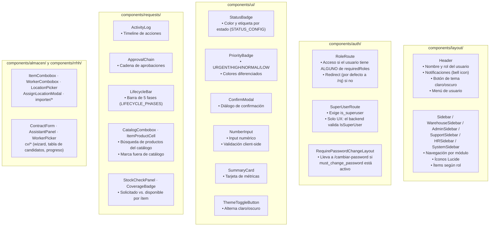

### 3.3 Estructura de Archivos del Frontend

```text
frontend/src/
├── App.jsx                 # Router principal
├── main.jsx                # Entry point
├── index.css               # Estilos globales, tokens y capa de compatibilidad del tema oscuro
├── api/                    # 18 archivos
│   ├── client.js           # instancia Axios, CSRF e interceptor 401
│   ├── config.js           # API_BASE_URL, BACKEND_URL
│   ├── index.js            # exporta auth, requests, core, suppliers, notifications,
│   │                       #   claims, workflow y hr; el resto se importa directo
│   ├── auth.js · users.js · projects.js · core.js
│   ├── requests.js · suppliers.js · claims.js · notifications.js · workflow.js
│   ├── almacen.js · almacenImport.js · warehouse.js
│   ├── administracion.js · support.js · hr.js
├── context/
│   ├── AuthContext.jsx     # currentUser, login, logout, userRoles, hasRole, isSuperUser
│   ├── ToastContext.jsx    # showToast
│   └── ThemeContext.jsx    # mode (claro/oscuro/auto), autoRange, resolvedTheme
├── hooks/                  # useApi, useFileDownload, useFileDrop, useFocusFirstInvalid,
│                           #   useCVAnalysis/Config/Progress/Upload, useMediaQuery, ...
├── data/                   # constants.js, almacenConstants.js, almacenRoles.js,
│                           #   requestCapture.js, supportConstants.js, mockData.js
├── utils/                  # format, exportRQ (ExcelJS), theme, quantity, stockCheck,
│                           #   requestCapture, almacen*, apiErrors, cv*, hrErrors, download
├── pages/                  # 51 páginas
│   ├── auth/               # LoginPage, SystemSelectPage, ChangePasswordRequiredPage
│   ├── dashboard/          # DashboardPage
│   ├── requests/           # lista, creación y detalle
│   ├── approvals/          # ApprovalsPage y 5 pantallas de revisión
│   ├── operations/         # LogisticsPage, LogisticsActionPage
│   ├── almacen/            # 11 páginas de almacén
│   ├── admin/              # menú, dashboard, pasajes, pagos, políticas, proveedores
│   ├── rrhh/               # documentos, plantillas, análisis de CVs
│   ├── sistema/            # usuarios y proyectos
│   ├── support/            # 4 páginas de soporte
│   ├── reports/            # ReportsPage
│   └── settings/           # SettingsPage
├── components/             # 79 archivos
│   ├── layout/ · auth/ · ui/ · requests/
│   ├── almacen/ (incluye importer/) · rrhh/ (incluye cv/) · sistema/
└── test/                   # utilidades de Vitest (se prueban 157 archivos *.test.*)
```

### 3.4 Tema Claro/Oscuro

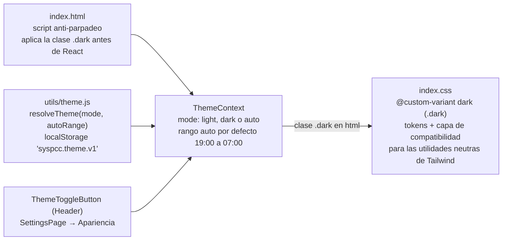

La resolución del tema vive en `utils/theme.js` y se replica en el script de `index.html`; ambos deben mantenerse iguales. En modo automático se programa un único temporizador hasta el siguiente límite del rango y se reevalúa al volver a la pestaña.

---

## 4. Capa de Comunicación API

### 4.1 Flujo Request/Response completo

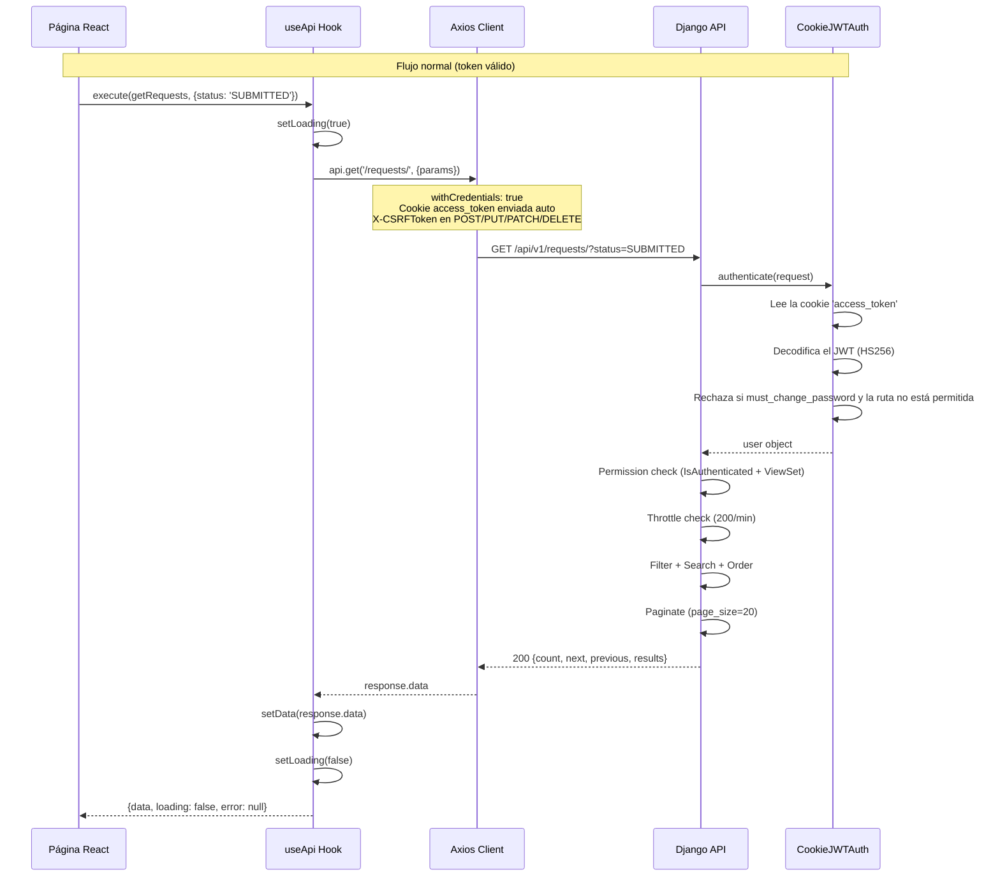

### 4.2 Flujo ante un 401 (token expirado)

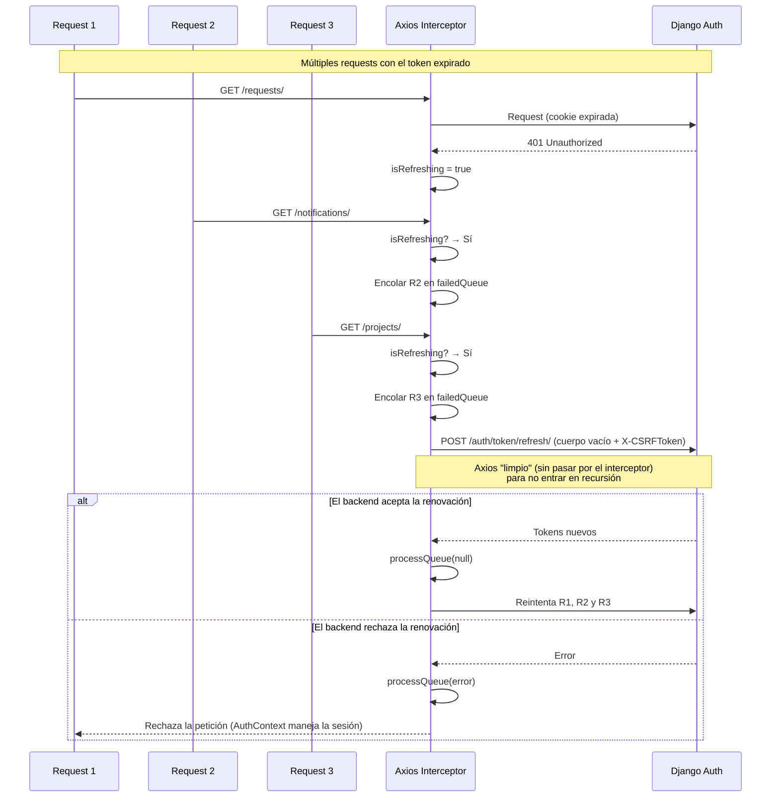

Brecha conocida: la vista `/auth/token/refresh/` es el `TokenRefreshView` estándar de SimpleJWT, que lee `refresh` del cuerpo de la petición. El interceptor la llama con el cuerpo vacío (el refresh vive en una cookie `httpOnly` que el navegador no puede leer), por lo que la renovación depende de ese comportamiento del servidor. El código de pruebas de `apps/core` la reconoce como una brecha preexistente (`test_must_change_password_gate.py`).

Además, el interceptor redirige a `/cambiar-password` cuando recibe un 403 con `code: "must_change_password"`.

### 4.3 Estructura del Axios Client

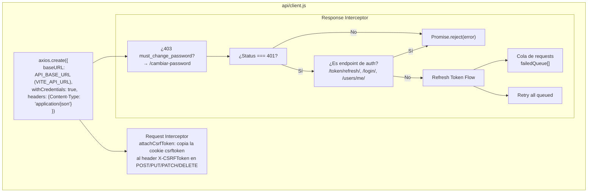

---

## 5. Motor de Workflow — Máquina de Estados Detallada

El motor (`apps/rq/services/workflow_engine.py`) define 71 transiciones en la lista `TRANSITIONS` y valida cada acción contra el flujo del RQ, su estado actual y el rol del usuario. `RQStatusChoices` define 47 estados; 37 de ellos intervienen en las transiciones. Los flujos los define gerencia y no se modifican; los diagramas siguientes solo los describen con los nombres reales de las acciones (`ApprovalActionChoices`).

### 5.1 Flujo OPERATIONS — Diagrama Completo

```mermaid
stateDiagram-v2
    [*] --> DRAFT

    state "FASE 1 — Solicitud" as F1 {
        DRAFT --> SUBMITTED: SUBMITTED<br/>[REQUESTER]
    }

    state "FASE 2 — Validación Técnica y Presupuestal" as F2 {
        SUBMITTED --> TECHNICAL_APPROVED: TECHNICAL_APPROVED<br/>[PROJECT_RESIDENT]
        SUBMITTED --> TECHNICAL_REJECTED: TECHNICAL_REJECTED<br/>[PROJECT_RESIDENT]

        TECHNICAL_APPROVED --> WITHIN_PROPOSAL: BUDGET_CLASSIFIED (BC_WITHIN_PROPOSAL)<br/>[PROJECT_CONTROL]
        TECHNICAL_APPROVED --> ADDITIONAL_REQ: BUDGET_CLASSIFIED (BC_ADDITIONAL)<br/>[PROJECT_CONTROL]
        TECHNICAL_APPROVED --> TECHNICAL_REJECTED: BUDGET_REJECTED<br/>[PROJECT_CONTROL]

        WITHIN_PROPOSAL --> VALIDATED: VALIDATED (sistema)

        ADDITIONAL_REQ --> GM_REVIEW: TECHNICAL_APPROVED<br/>[PROJECT_RESIDENT]
        ADDITIONAL_REQ --> TECHNICAL_REJECTED: TECHNICAL_REJECTED<br/>[PROJECT_RESIDENT]

        GM_REVIEW --> GM_APPROVED: GM_APPROVED<br/>[GENERAL_MANAGER]
        GM_REVIEW --> GM_REJECTED: GM_REJECTED<br/>[GENERAL_MANAGER]

        GM_APPROVED --> VALIDATED: VALIDATED (sistema)
    }

    state "FASE 3 — Logística y Compras" as F3 {
        VALIDATED --> IN_STOCK: STOCK_CHECKED (has_stock=true)<br/>[LOGISTICS_COORDINATOR]
        VALIDATED --> REQUIRES_PURCHASE: STOCK_CHECKED (has_stock=false)<br/>[LOGISTICS_COORDINATOR]

        REQUIRES_PURCHASE --> QUOTING: QUOTE_REQUESTED<br/>[LOGISTICS_COORDINATOR]
        QUOTING --> QUOTE_COMPARISON: QUOTE_COMPARED<br/>[LOGISTICS_COORDINATOR]
        QUOTE_COMPARISON --> QUOTE_SELECTED: QUOTE_SELECTED<br/>[LOGISTICS_COORDINATOR]

        QUOTE_SELECTED --> QUOTE_COST_APPROVED: QUOTE_COST_APPROVED<br/>[PROJECT_CONTROL]
        QUOTE_SELECTED --> COST_OVERRUN_REVIEW: QUOTE_COST_REJECTED<br/>[PROJECT_CONTROL]

        COST_OVERRUN_REVIEW --> COST_OVERRUN_APPROVED: COST_OVERRUN_APPROVED<br/>[GENERAL_MANAGER]
        COST_OVERRUN_REVIEW --> COST_OVERRUN_REJECTED: COST_OVERRUN_REJECTED<br/>[GENERAL_MANAGER]

        QUOTE_COST_APPROVED --> PO_GENERATED: PO_GENERATED<br/>[LOGISTICS_COORDINATOR]
        COST_OVERRUN_APPROVED --> PO_GENERATED: PO_GENERATED<br/>[LOGISTICS_COORDINATOR]
    }

    state "FASE 4 — Recepción y Entrega" as F4 {
        PO_GENERATED --> RECEIVING: RECEIVED<br/>[LOGISTICS_COORDINATOR]

        IN_STOCK --> DISPATCHED_TO_SITE: DISPATCHED<br/>[CENTRAL_WAREHOUSE]

        RECEIVING --> QUALITY_APPROVED: QUALITY_APPROVED<br/>[LOGISTICS_COORDINATOR]
        RECEIVING --> QUALITY_REJECTED: QUALITY_REJECTED<br/>[LOGISTICS_COORDINATOR]

        QUALITY_APPROVED --> DISPATCHED_TO_SITE: DISPATCHED<br/>[LOGISTICS_COORDINATOR]
        DISPATCHED_TO_SITE --> DELIVERED: WAREHOUSE_RECORDS_UPDATED<br/>[SITE_WAREHOUSE]

        state "Ciclo de Reclamo" as CLAIM_CYCLE {
            QUALITY_REJECTED --> SUPPLIER_CLAIM_SENT: SUPPLIER_CLAIM_SENT<br/>[LOGISTICS_COORDINATOR]
            SUPPLIER_CLAIM_SENT --> SUPPLIER_CLAIM_PENDING: SUPPLIER_CLAIM_UPDATED<br/>[LOGISTICS_COORDINATOR]
            SUPPLIER_CLAIM_PENDING --> SUPPLIER_REPLACEMENT_RECEIVED: SUPPLIER_REPLACEMENT_RECEIVED<br/>[LOGISTICS_COORDINATOR]
            SUPPLIER_CLAIM_SENT --> SUPPLIER_REPLACEMENT_RECEIVED: SUPPLIER_REPLACEMENT_RECEIVED (directo)
            SUPPLIER_REPLACEMENT_RECEIVED --> QUALITY_APPROVED: QUALITY_APPROVED
            SUPPLIER_REPLACEMENT_RECEIVED --> QUALITY_REJECTED: QUALITY_REJECTED
        }
    }

    state "FASE 5 — Conformidad y Cierre" as F5 {
        DELIVERED --> USER_CONFORMITY: USER_CONFIRMED<br/>[REQUESTER]
        DELIVERED --> CLAIM_IN_REVIEW: USER_CLAIMED<br/>[REQUESTER]

        CLAIM_IN_REVIEW --> SUPPLIER_CLAIM_SENT: SUPPLIER_CLAIM_SENT<br/>[LOGISTICS_COORDINATOR]

        USER_CONFORMITY --> CLOSED: CLOSED<br/>[LOGISTICS_COORDINATOR]
    }

    state "Cancelación Universal" as CANCEL {
        note right of CANCELLED: Cualquier estado no-terminal<br/>puede pasar a CANCELLED (acción CANCELLED).<br/>La tabla no exige un rol concreto
    }

    TECHNICAL_REJECTED --> [*]
    GM_REJECTED --> [*]
    COST_OVERRUN_REJECTED --> [*]
    CLOSED --> [*]
    CANCELLED --> [*]
```

### 5.2 Flujo ADMINISTRATIVE — Diferencias con OPERATIONS

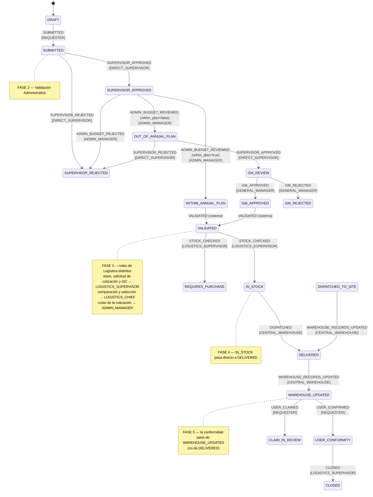

En este flujo también cambia el reclamo al proveedor: `QUALITY_REJECTED → SUPPLIER_CLAIM_SENT → SUPPLIER_REPLACEMENT_RECEIVED` (sin el paso intermedio `SUPPLIER_CLAIM_PENDING`), ejecutado por el Supervisor Logístico.

### 5.3 Componentes Internos del WorkflowEngine

```mermaid
graph TB
    subgraph "WorkflowEngine(request, user, acting_role)"
        ENTRY["execute(action, comments, extra_data)<br/>@transaction.atomic"]

        subgraph "Paso 1: Validación"
            V0["_validate_acting_role()<br/>• El usuario debe tener asignado en BD<br/>  el acting_role declarado"]
            V1["select_for_update() sobre el Request<br/>• Relee el estado bajo bloqueo<br/>• Rechaza acciones sobre RQ terminales<br/>  (salvo CANCELLED)"]
            V2["_find_transition(action)<br/>• Busca en TRANSITIONS por flujo,<br/>  estado actual y acción"]
            V3["_check_role_permission()<br/>• El usuario debe tener el required_role en BD<br/>• CANCELLED y acciones de sistema<br/>  no exigen un rol concreto"]
        end

        subgraph "Paso 2: Ejecución"
            E1["Handler condicional (si existe)<br/>• handle_ops_budget_classification (classification)<br/>• handle_adm_budget_review (within_plan)<br/>• handle_stock_check (has_stock)<br/>• handle_cancellation"]
            E2["Actualiza request.status y current_step<br/>(_get_workflow_step)"]
        end

        subgraph "Paso 3: Efectos laterales"
            B1["_on_validated()<br/>• SLACalculator.calculate_estimated_delivery<br/>• BudgetValidator.commit_budget"]
            B2["_on_terminal_rejection()<br/>• BudgetValidator.release_budget<br/>• Rechazos y CANCELLED"]
            B3["_on_material_received() · _on_dispatched()<br/>• Lote de ingreso o egreso en almacén CENTRAL<br/>• WarehouseReceipt / WarehouseDispatch<br/>• Best-effort: un fallo no revierte el flujo"]
        end

        subgraph "Paso 4: Registro"
            R1["Approval (inmutable)<br/>• previous_status, new_status<br/>• performed_by, role, comments"]
            R2["_log_activity()<br/>• ActivityLog"]
            R3["_send_notifications()<br/>• NotificationService.notify_on_transition"]
        end

        subgraph "Paso 5: Cadena de sistema"
            A1["_execute_system_chain()<br/>• WITHIN_PROPOSAL → VALIDATED<br/>• WITHIN_ANNUAL_PLAN → VALIDATED<br/>• GM_APPROVED → VALIDATED<br/>• Approval con rol SYSTEM"]
        end

        AV["get_available_actions()<br/>• Acciones que el usuario puede ejecutar<br/>  sobre el RQ en su estado actual"]
    end

    ENTRY --> V0 --> V1 --> V2 --> V3 --> E1 --> E2 --> B1
    E2 --> B2
    E2 --> B3
    B1 --> R1
    B2 --> R1
    B3 --> R1
    R1 --> R2 --> R3 --> A1
```

### 5.4 Captura de Ítems y Vínculo con el Catálogo del Almacén (SYSPCC-026)

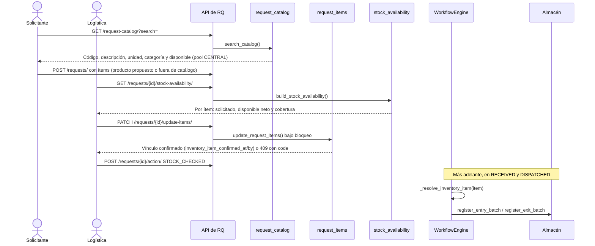

Reglas relevantes:

- **Búsqueda del catálogo** (`GET /request-catalog/`): abierta a todo usuario autenticado, mínimo 2 caracteres, 20 filas por página; no expone costos, ubicación exacta ni proveedores.
- **Propuesta vs. confirmación**: lo que elige el solicitante es una propuesta. Solo `update-items` (roles de logística) sella `inventory_item_confirmed_at` y `inventory_item_confirmed_by`.
- **Ventana editable de `update-items`**: desde VALIDATED hasta antes del despacho (`EDITABLE_STATUSES`). Responde 409 con `code` (`REQUEST_TERMINAL`, `REQUEST_STATE_NOT_EDITABLE`, `ITEMS_ALREADY_DISPATCHED`, `ITEMS_ALREADY_RECEIVED`, `INTEGRITY_ERROR`) y no escribe nada. Este guard vive solo en ese endpoint: nunca bloquea una transición del flujo.
- **Disponibilidad**: informativa, solo para logística. Resta lo comprometido con otros RQ (los que están en IN_STOCK y las compras ya recibidas pendientes de despacho) y lo que toman las líneas previas del mismo RQ. Si la unidad del ítem y la del producto difieren, la cobertura es `NOT_COMPARABLE`.
- **Resolución del producto en el motor** (`_resolve_inventory_item`): un ítem marcado fuera de catálogo nunca mueve stock; si hay vínculo directo se usa; si no, el motor conserva un respaldo por coincidencia de texto y deja una advertencia en el log.
- **Comandos de apoyo** (solo lectura): `check_central_project_stock`, `report_rq_stock_gaps` y `suggest_inventory_links`.

---

## 6. Arquitectura de Autenticación y Autorización

### 6.1 Flujo de Autenticación JWT Cookie-Based

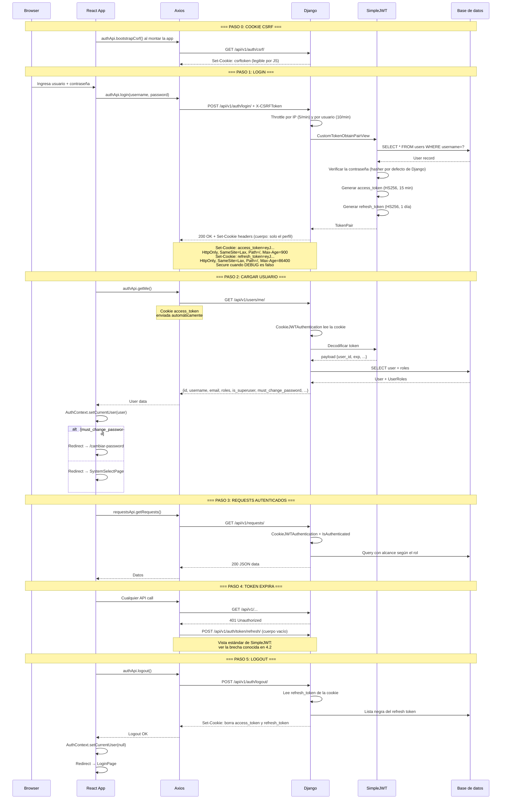

### 6.2 RBAC — Control de Acceso Basado en Roles

```mermaid
graph TB
    subgraph "Permission Classes (apps/core/permissions.py)"
        IA["IsAuthenticated<br/>(DRF built-in)<br/>Token JWT válido"]
        HR["HasRole<br/>Roles en view.role_required<br/>(definida, sin uso en vistas hoy)"]
        IGM["IsGeneralManager<br/>Solo GENERAL_MANAGER<br/>(definida, sin uso en vistas hoy)"]
        ILS["IsLogisticsStaff<br/>LOGISTICS_COORDINATOR<br/>LOGISTICS_SUPERVISOR<br/>LOGISTICS_CHIEF"]
        IWS["IsWarehouseStaff<br/>CENTRAL_WAREHOUSE · SITE_WAREHOUSE<br/>(definida, sin uso en vistas hoy)"]
        IHR["IsHRManager<br/>ADMIN_MANAGER · PASAJES_MANAGER<br/>GENERAL_MANAGER · staff<br/>(leer Personal completo)"]
        IPS["IsPasajesStaff<br/>PASAJES_MANAGER · ADMIN_MANAGER · staff<br/>(búsqueda por DNI)"]
        IHD["IsHRDocumentsManager<br/>HR_MANAGER (sin bypass de staff)<br/>IsHRDocumentsReader: + GENERAL_MANAGER"]
        ISU["IsSuperUser<br/>is_superuser<br/>(usuarios, roles y proyectos)"]
        IAR["IsAdminOrReadOnly<br/>Auth: lectura<br/>Staff: escritura"]
    end

    subgraph "Permisos propios por app"
        RQP["rq/permissions.py<br/>get_accessible_requests_queryset<br/>CanPerformWorkflowAction"]
        WHP["warehouse/permissions.py<br/>IsWarehouseRole, CanImportInventory,<br/>CanAssignLocations, CanLinkPersonal,<br/>CanDeliverEPP, CanLookupPersonal"]
        ADP["administracion/views.py<br/>IsAdminOrAdminManager<br/>ADMIN_MANAGER · GENERAL_MANAGER<br/>PASAJES_MANAGER · staff"]
    end

    subgraph "Aplicación en ViewSets"
        RV["RequestViewSet<br/>IsAuthenticated + alcance del queryset<br/>update-items y stock-availability: IsLogisticsStaff<br/>action: CanPerformWorkflowAction"]
        SV["QuotationViewSet · PurchaseOrderViewSet<br/>lectura: IsAuthenticated con alcance<br/>escritura: IsLogisticsStaff"]
        UV["UserViewSet · ProjectViewSet<br/>lectura: IsAuthenticated<br/>escritura: IsSuperUser"]
        WV["Warehouse ViewSets<br/>IsWarehouseRole y permisos por acción"]
        AV["Administración ViewSets<br/>IsAdminOrAdminManager"]
        HV["HR ViewSets<br/>IsHRDocumentsReader (lectura)<br/>IsHRDocumentsManager (escritura)"]
        PV["PersonalViewSet<br/>lectura completa: IsHRManager<br/>búsqueda por DNI: IsPasajesStaff<br/>escritura: staff"]
        SUP["SupplierViewSet · DepartmentViewSet<br/>lectura: IsAuthenticated<br/>escritura: IsAdminOrReadOnly (staff)"]
    end

    subgraph "Verificación en WorkflowEngine"
        WFP["TRANSITIONS[..].required_role<br/>→ el usuario debe tener ese rol (BD)<br/>→ además debe tener el acting_role declarado<br/>→ si no: PermissionDeniedForAction (403)"]
    end

    subgraph "Frontend"
        FRR["RoleRoute · SuperUserRoute<br/>requiredRoles={['PROJECT_RESIDENT']}<br/>→ useAuth().userRoles<br/>→ si no tiene rol: redirect<br/>(solo UX; el backend valida)"]
    end

    IA --> RV
    ILS --> RV
    ILS --> SV
    ISU --> UV
    RQP --> RV
    WHP --> WV
    ADP --> AV
    IHD --> HV
    IHR --> PV
    IPS --> PV
    IAR --> SUP
    RV --> WFP
```

### 6.3 Roles Requeridos por Endpoint

| Endpoint | Roles requeridos |
|----------|------------------|
| `POST /requests/` | Cualquier usuario autenticado (la UI está pensada para el Solicitante) |
| `GET /requests/` y detalle | Alcance por rol: roles amplios (`GENERAL_MANAGER`, logística, `CENTRAL_WAREHOUSE`) ven todo; Residente, Control y Almacén de Obra ven su proyecto; Jefe Directo y Gerente Administrativo ven su departamento; el resto, solo lo propio |
| `POST /requests/{id}/action/` | El rol `required_role` de la transición y que el usuario posea el `acting_role` enviado |
| `PATCH /requests/{id}/update-items/`, `GET /requests/{id}/stock-availability/` | `LOGISTICS_COORDINATOR`, `LOGISTICS_SUPERVISOR` o `LOGISTICS_CHIEF` |
| `GET /request-catalog/` | Cualquier usuario autenticado |
| `POST /quotations/`, `POST /quotations/{id}/select/`, `POST /purchase-orders/` | Roles de logística |
| `POST /suppliers/` (escrituras) | Usuario staff (`IsAdminOrReadOnly`); lectura para cualquier usuario autenticado |
| `/warehouse/*` | `CENTRAL_WAREHOUSE`, `SITE_WAREHOUSE` o roles de logística; asignar ubicaciones, importar y vincular destinos: `CENTRAL_WAREHOUSE` y `LOGISTICS_CHIEF`; entrega de EPP: `CENTRAL_WAREHOUSE` y `SITE_WAREHOUSE`; sin bypass por superusuario |
| `/administracion/*` | `ADMIN_MANAGER`, `GENERAL_MANAGER`, `PASAJES_MANAGER` o staff (el tipo de cambio, `/administracion/tipo-cambio/`, solo pide estar autenticado) |
| `/hr/*` | `HR_MANAGER` (escritura); `HR_MANAGER` y `GENERAL_MANAGER` (lectura); sin bypass de staff |
| `POST/PUT/PATCH /users/`, `/user-roles/`, `/projects/` | `is_superuser` |
| `/support/tickets/` | Cualquier usuario autenticado; cada uno ve sus tickets y el staff ve todos |

---

## 7. Arquitectura de Tareas Asíncronas (Celery)

### 7.1 Flujo de Tareas

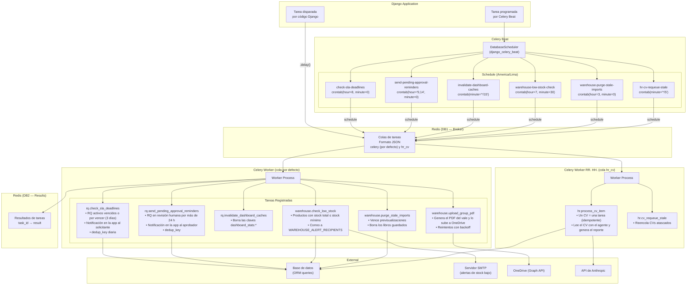

Las notificaciones de las transiciones del RQ, de SLA y de recordatorios son notificaciones dentro de la aplicación (modelo `Notification`); el único correo que envía el sistema es la alerta de stock bajo. En el entorno `demo` no hay worker ni Beat: Celery corre en modo eager y las tareas programadas no se ejecutan.

### 7.2 Configuración de Celery

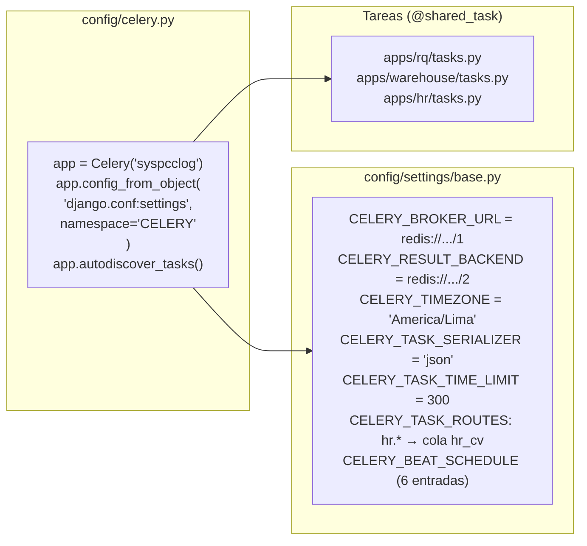

Procesos en Docker Compose local: `celery_worker` (`celery -A config worker`), `celery_worker_hr` (`celery -A config worker -Q hr_cv -c 3`) y `celery_beat` (`--scheduler django_celery_beat.schedulers:DatabaseScheduler`).

---

## 8. Arquitectura de Caché y Sesiones

### 8.1 Distribución de Redis

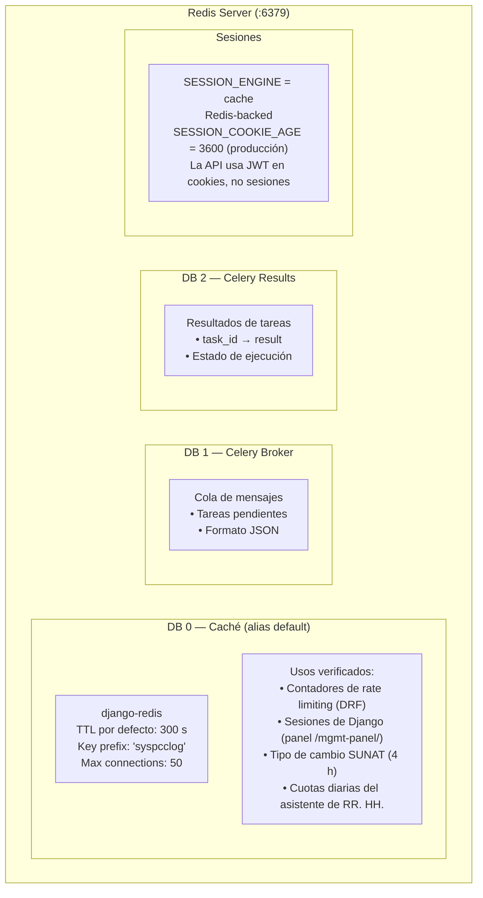

### 8.2 Uso de la caché en el código

La API no cachea listados ni consultas generales. Lo que existe es:

- **Rate limiting**: los contadores de DRF viven en la caché indicada por `THROTTLE_CACHE_ALIAS`. Si se activa `DJANGO_REDIS_IGNORE_EXCEPTIONS`, producción los mueve a una caché local de proceso para que los límites no desaparezcan con una caída de Redis.
- **Tipo de cambio**: `GET /administracion/tipo-cambio/` guarda la respuesta del servicio externo por 4 horas.
- **Ayudantes de `apps/rq/cache.py`**: funciones para cachear los pasos del workflow y la configuración de tipos de adquisición (TTL de 1 hora) y para invalidar las claves `dashboard_stats:*`. Hoy solo se usa `safe_delete_pattern`, desde la tarea `rq.invalidate_dashboard_caches`; no hay llamadores de lectura/escritura de esas claves en vistas o servicios.
- **Entorno demo**: la caché es `LocMemCache` (por proceso), sin Redis.

---

## 9. Modelo de Datos — Relaciones Detalladas

### 9.1 Diagrama ER Completo

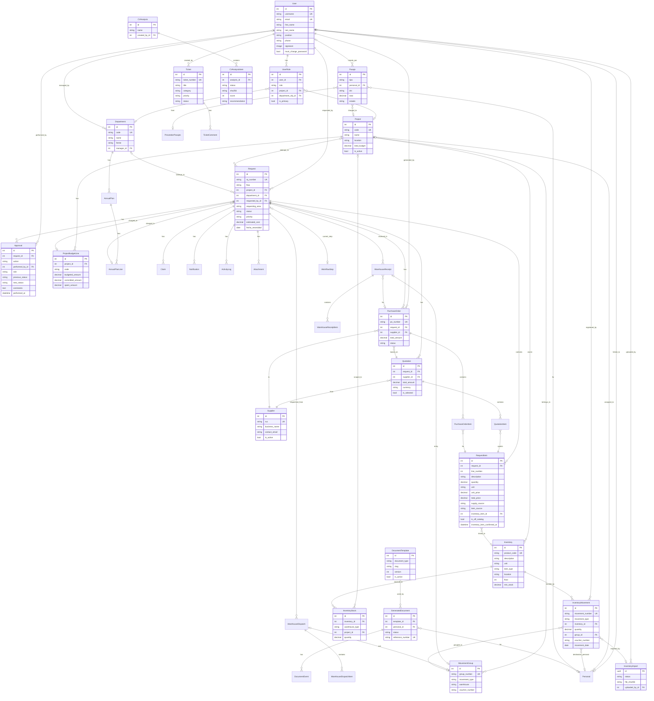

---

## 10. Rate Limiting y Throttling

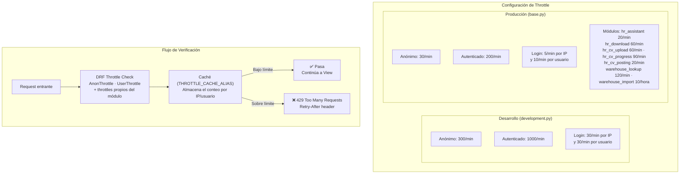

El catálogo de búsqueda de RQ (`/request-catalog/`) tiene su propio throttle (`RequestCatalogThrottle`) además del de usuario.

---

*Documento de arquitectura de bajo nivel de SYSPCC — PCC Ingeniería y Construcción*
*Última actualización: Octubre 2026 (código al día con SYSPCC-026)*
