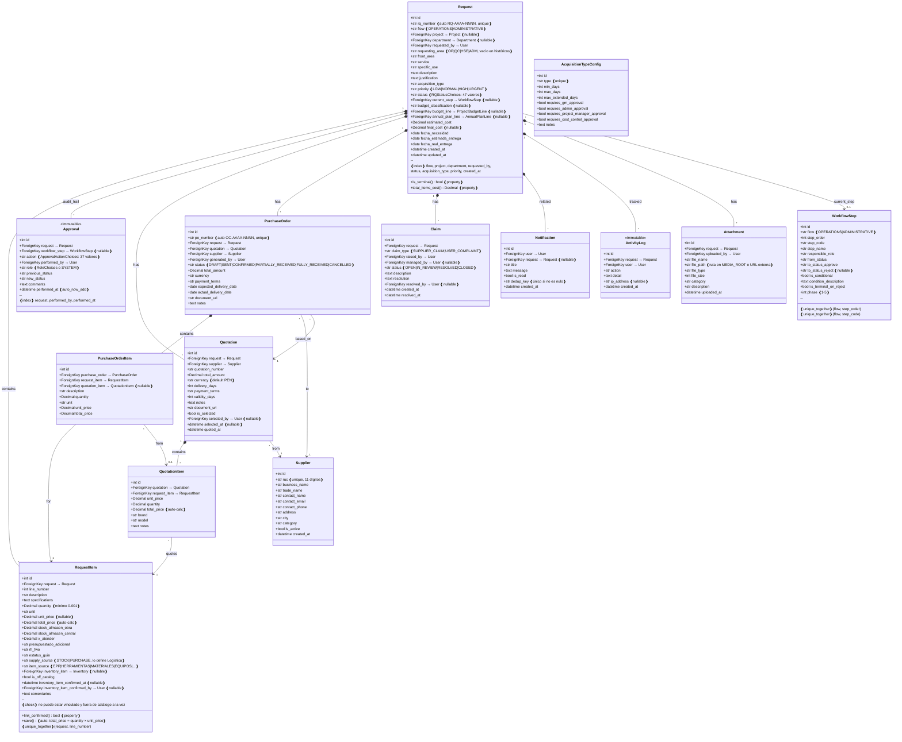
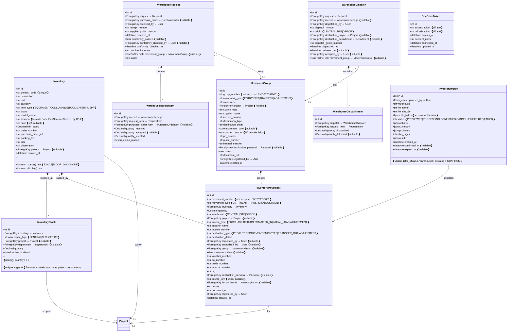
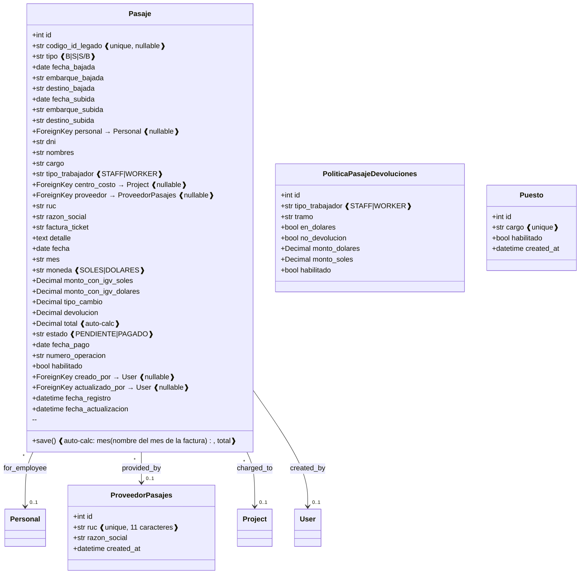
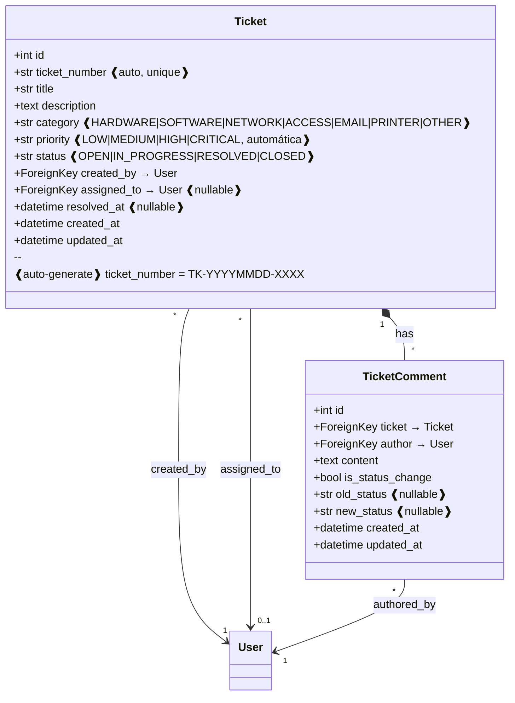
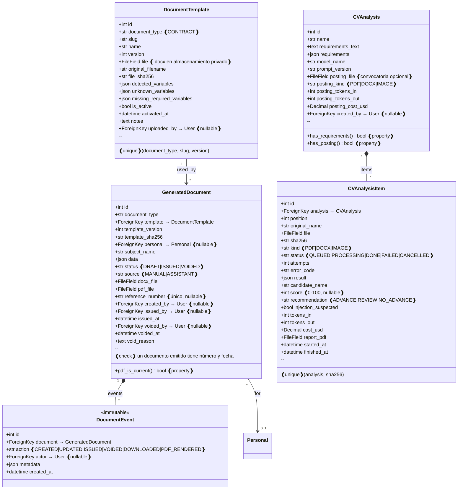
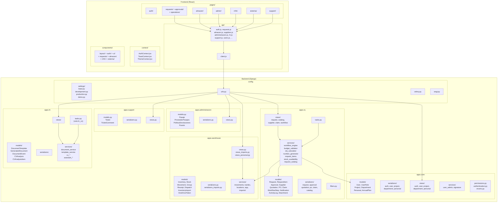

# SYSPCC — Diagrama de Clases

**Sistema de Gestión de Requerimientos de Abastecimiento**
**Versión:** 1.1 | **Fecha:** Octubre 2026 | **Empresa:** PCC Ingeniería y Construcción

---

## 1. Diagrama de Clases Completo — Módulo Core

```mermaid
classDiagram
    direction TB

    class User {
        <<Django AbstractUser>>
        +int id
        +str username
        +str email ❰unique❱
        +str first_name
        +str last_name
        +str position
        +str department
        +str phone
        +str avatar_url
        +ImageField signature
        +bool must_change_password
        +datetime date_joined
        +bool is_active
        +bool is_staff
        +bool is_superuser
        --
        +full_name() str ❰property❱
        +get_roles() QuerySet~UserRole~
        +has_role(role: str) bool
    }

    class UserRole {
        +int id
        +ForeignKey user → User
        +str role ❰RoleChoices❱
        +ForeignKey project → Project ❰nullable❱
        +ForeignKey department_obj → Department ❰nullable❱
        +bool is_primary
        +datetime assigned_at
        --
        ❰unique_together❱ (user, role, project, department_obj)
    }

    class RoleChoices {
        <<enumeration>>
        REQUESTER
        PROJECT_RESIDENT
        PROJECT_CONTROL
        GENERAL_MANAGER
        LOGISTICS_COORDINATOR
        CENTRAL_WAREHOUSE
        SITE_WAREHOUSE
        DIRECT_SUPERVISOR
        ADMIN_MANAGER
        LOGISTICS_SUPERVISOR
        LOGISTICS_CHIEF
        PASAJES_MANAGER
        HR_MANAGER
    }

    class Project {
        +int id
        +str code ❰unique❱
        +str name
        +str location
        +str client
        +str frente
        +Decimal total_budget ❰nullable❱
        +date start_date
        +date end_date
        +bool is_active
        +datetime created_at
        +datetime updated_at
    }

    class ProjectBudgetLine {
        +int id
        +ForeignKey project → Project
        +str code
        +str description
        +Decimal budgeted_amount
        +Decimal committed_amount
        +Decimal spent_amount
        --
        +available_amount() Decimal ❰property❱
        ❰unique_together❱ (project, code)
    }

    class Department {
        +int id
        +str code ❰unique❱
        +str name
        +str frente ❰default OFICINA CENTRAL❱
        +ForeignKey manager → User ❰nullable❱
        +bool is_active
    }

    class AnnualPlan {
        +int id
        +int year
        +ForeignKey department → Department
        +Decimal total_budget
        +ForeignKey approved_by → User ❰nullable❱
        +datetime approved_at
        +bool is_active
        --
        ❰unique_together❱ (year, department)
    }

    class AnnualPlanLine {
        +int id
        +ForeignKey annual_plan → AnnualPlan
        +str code
        +str description
        +str category
        +Decimal budgeted_amount
        +Decimal committed_amount
        +Decimal spent_amount
        --
        +available_amount() Decimal ❰property❱
        ❰unique_together❱ (annual_plan, code)
    }

    class Personal {
        +int id
        +OneToOneField user → User ❰nullable❱
        +str dni ❰unique❱
        +str apellidos_nombres
        +date fecha_nacimiento
        +str sexo ❰M|F❱
        +str estado_civil
        +str celular
        +str email_personal
        +str contacto_emergencia_nombre
        +str contacto_emergencia_telefono
        +str contacto_emergencia_vinculo
        +str departamento_residencia
        +str provincia_residencia
        +str distrito_residencia
        +str direccion_residencia
        +str nivel_educativo
        +str grado_academico
        +str especialidad_carrera
        +str estado ❰ACTIVO|CESADO|VACACIONES|LICENCIA❱
        +date fecha_ingreso
        +date fecha_cese
        +str motivo_cese
        +ForeignKey proyecto → Project ❰nullable❱
        +str sede
        +str puesto
        +str guardia ❰A|B|C|D❱
        +str condicion_trabajo ❰PLANILLA|RECIBO|CONTRATO❱
        +Decimal salario
        +str sistema_pensiones
        +str entidad_bancaria
        +str numero_cuenta
        +str cci
        +bool tiene_hijos
        +bool hijos_menores_18
        +int cantidad_hijos_menores
        +text nombres_hijos_menores
        +bool asignacion_familiar
        +str numero_fotocheck
        +str talla_zapato
        +str talla_pantalon
        +str talla_camisa
        --
        +edad() int ❰property❱
    }

    User "1" --> "*" UserRole : has
    UserRole --> RoleChoices : uses
    UserRole "*" --> "0..1" Project : scoped_to
    UserRole "*" --> "0..1" Department : scoped_to
    Project "1" --> "*" ProjectBudgetLine : has
    Department "1" --> "*" AnnualPlan : has
    AnnualPlan "1" --> "*" AnnualPlanLine : has
    Department "*" --> "0..1" User : managed_by
    Personal "0..1" --> "0..1" User : linked_to
    Personal "*" --> "0..1" Project : assigned_to
    AnnualPlan "*" --> "0..1" User : approved_by
```

El acceso a `Personal` está restringido: los datos completos (salario, cuenta bancaria, domicilio, contacto de emergencia) los leen solo roles de RR. HH. autorizados; el módulo de pasajes y el de almacén consultan versiones reducidas.

---

## 2. Diagrama de Clases — Módulo RQ (Requerimientos)

Observaciones del módulo:

- La creación de un RQ por la API (`POST /requests/`) lo registra directamente en `SUBMITTED` junto con su primera aprobación; el valor `DRAFT` queda como estado inicial de la máquina de estados.
- El vínculo `RequestItem.inventory_item` (o la marca `is_off_catalog`) que envía el solicitante es una **propuesta**; Logística la confirma y deja constancia en `inventory_item_confirmed_at` y `inventory_item_confirmed_by`.
- `Approval` y `ActivityLog` los escribe el motor del flujo en cada transición; la creación del RQ registra además su primera `Approval`, y `update-items` deja entradas de `ActivityLog`. `Notification` nace de las transiciones y de las tareas programadas de SLA y recordatorios.
- `PurchaseOrder`, `Claim` y `Attachment` cuentan con modelo y endpoints, pero el SPA actual no los escribe: la acción `PO_GENERATED` y el ciclo de reclamo se registran como transiciones del flujo, y los adjuntos solo se consultan.

---

## 3. Diagrama de Clases — Módulo Almacén

Observaciones del módulo:

- El stock se guarda por `(producto, tipo de almacén, proyecto, departamento)`. El pool que usan los RQ para verificar disponibilidad es el almacén `CENTRAL` sin proyecto ni departamento.
- `WarehouseReceipt` y `WarehouseDispatch` los crea el `WorkflowEngine` al ejecutar las acciones `RECEIVED` y `DISPATCHED`, de forma tolerante a errores (si fallan, el flujo continúa y queda una advertencia en el log).
- Los tokens de `OneDriveToken` se cifran en reposo.
- Las ubicaciones siguen el formato definido por gerencia `{Pabellón}{Sección}-{Nivel}` (pabellones A a K, niveles 1 a 5); la validación está en `warehouse/services/locations.py`.

---

## 4. Diagrama de Clases — Módulo Administración

El `total` se calcula en soles: `monto_con_igv_soles - devolucion` si la moneda es SOLES; `monto_con_igv_dolares × tipo_cambio - devolucion` si es DOLARES.

---

## 5. Diagrama de Clases — Módulo Soporte TI

La prioridad no la elige el usuario: `auto_assign_priority` la deduce de palabras clave del título y la descripción y de la categoría (las categorías `NETWORK` y `ACCESS` parten en `HIGH`).

---

## 6. Diagrama de Clases — Módulo RR. HH.

Observaciones del módulo:

- Los archivos (plantillas, contratos, CVs, reportes) se guardan en almacenamiento privado fuera de `MEDIA_ROOT` y se entregan solo mediante vistas con permiso.
- Un documento emitido queda congelado; solo se anula con motivo. Cada cambio deja un `DocumentEvent`.
- La nota (`score`) y la recomendación de un CV son una sugerencia; la decisión es humana. El estado agregado de un análisis (`EMPTY`, `PROCESSING`, `COMPLETED_WITH_ERRORS`, `COMPLETED`) se calcula a partir de sus CVs y no se almacena.

---

## 7. Diagrama de Clases — Servicios de Negocio

```mermaid
classDiagram
    direction TB

    class WorkflowEngine {
        <<Service>>
        +WorkflowEngine(request, user, acting_role)
        +execute(action, comments, extra_data) Approval
        +get_available_actions() List~dict~
        -_validate_acting_role() void
        -_find_transition(action) dict
        -_check_role_permission(transition) void
        -_apply_side_effects(action, previous, new, extra) void
        -_on_validated(extra_data) void
        -_on_terminal_rejection() void
        -_on_material_received(extra_data) void
        -_on_dispatched(extra_data) void
        -_resolve_inventory_item(item) Inventory
        -_execute_system_chain(status) void
        -_log_activity(action, previous, new) void
        -_send_notifications(action, new_status) void
        +handle_ops_budget_classification(transition, extra) str
        +handle_adm_budget_review(transition, extra) str
        +handle_stock_check(transition, extra) str
        +handle_cancellation(transition, extra) str
    }

    class BudgetValidator {
        <<Service>>
        +validate(request) dict
        +commit_budget(request) void
        +release_budget(request) void
    }

    class SLACalculator {
        <<Service>>
        +calculate_estimated_delivery(acquisition_type, from_date, use_max) date
        +get_sla_days(acquisition_type) dict
    }

    class RQNumberGenerator {
        <<Service>>
        +generate() str
    }

    class PONumberGenerator {
        <<Service>>
        +generate() str
    }

    class NotificationService {
        <<Service>>
        +notify_on_transition(request, action, new_status, actor) void
    }

    class RequestItemsService {
        <<Service>>
        +update_request_items(request, items_data, user) UpdateItemsResult
        +log_proposed_catalog_links(request, items, user) void
    }

    class StockAvailabilityService {
        <<Service>>
        +build_stock_availability(request) dict
        +committed_to_other_requests(inventory_ids, exclude_request_id) dict
    }

    class RequestCatalogService {
        <<Service>>
        +search_catalog(raw_term) QuerySet
        +central_pool_available(inventory_ids) dict
    }

    class WarehouseMovementsService {
        <<Service>>
        +register_entry_batch(...) MovementGroup
        +register_exit_batch(...) MovementGroup
        +register_entry(...) InventoryMovement
        +register_exit(...) InventoryMovement
        +register_adjustment(...) InventoryMovement
    }

    class EppService {
        <<Service>>
        +register_epp_delivery(...) MovementGroup
    }

    class InventoryImportService {
        <<Service>>
        +create_preview(uploaded_file, user, warehouse, update_existing) InventoryImport
        +confirm_import(...) InventoryImport
        +cancel_import(import_id) InventoryImport
        +purge_stale_imports(now) dict
    }

    class HRDocumentService {
        <<Service>>
        +create_draft(...) GeneratedDocument
        +update_draft(...) GeneratedDocument
        +issue(user, document_id) GeneratedDocument
        +void(user, document_id, reason) GeneratedDocument
        +render_pdf(user, document_id) GeneratedDocument
    }

    class CVAnalysisPipeline {
        <<Service>>
        +create_analysis(user, name, requirements_text) CVAnalysis
        +upload_files(analysis, user, files) dict
        +progress(analysis, since) dict
        +run_item(item_id) void
        +requeue_stale(analysis, limit) int
    }

    class CookieJWTAuthentication {
        <<Authentication>>
        +authenticate(request) tuple~User, token~
        +enforce_csrf(request) void
    }

    WorkflowEngine --> BudgetValidator : commit y release
    WorkflowEngine --> SLACalculator : fecha estimada
    WorkflowEngine --> NotificationService : usa
    WorkflowEngine --> WarehouseMovementsService : RECEIVED y DISPATCHED
    WorkflowEngine --> Request : modifica
    WorkflowEngine --> Approval : crea
    WorkflowEngine --> ActivityLog : crea
    WorkflowEngine --> WorkflowStep : lee
    BudgetValidator --> ProjectBudgetLine : modifica
    BudgetValidator --> AnnualPlanLine : modifica
    SLACalculator --> AcquisitionTypeConfig : lee
    RQNumberGenerator --> Request : genera número
    PONumberGenerator --> PurchaseOrder : genera número
    RequestItemsService --> RequestItem : confirma vínculos
    StockAvailabilityService --> RequestCatalogService : usa el pool CENTRAL
    EppService --> WarehouseMovementsService : reutiliza
    InventoryImportService --> WarehouseMovementsService : aplica ingresos y egresos
```

Los nombres de `InventoryImportService`, `HRDocumentService` y `CVAnalysisPipeline` agrupan funciones de los módulos `warehouse/services/imports/service.py`, `hr/services/document_service.py` y `hr/services/cv_analysis_service.py` / `cv_service.py`; no son clases con esos nombres en el código. Lo mismo ocurre con `RequestItemsService`, `StockAvailabilityService`, `RequestCatalogService`, `WarehouseMovementsService` y `EppService`, que representan módulos de funciones.

---

## 8. Diagrama de Clases — Frontend (React Components)

```mermaid
classDiagram
    direction TB

    class AuthContext {
        <<React Context>>
        +User currentUser
        +bool isAuthenticated
        +bool isLoading
        +str primaryRole
        +List~str~ userRoles
        +bool isSuperUser
        +login(username, password) Promise
        +logout() Promise
        +hasRole(role) bool
        +switchRole(user) void
    }

    class ToastContext {
        <<React Context>>
        +List~Toast~ toasts
        +showToast(config) void
    }

    class ThemeContext {
        <<React Context>>
        +str mode ❰light|dark|auto❱
        +str resolvedTheme ❰light|dark❱
        +object autoRange
        +setMode(mode) bool
        +setAutoRange(range) bool
        +toggleTheme() bool
    }

    class useApi {
        <<Custom Hook>>
        +T data
        +bool loading
        +str error
        +execute(...args) Promise
        +reset() void
    }

    class AppShell {
        <<Layout Component>>
        +Header header
        +Sidebar sidebar
        +Outlet content
        --
        theme: blue
        route: /rq/*
    }

    class WarehouseShell {
        <<Layout Component>>
        +Header header
        +WarehouseSidebar sidebar
        +Outlet content
        --
        theme: emerald
        route: /almacen/*
    }

    class AdminShell {
        <<Layout Component>>
        +Header header
        +AdminSidebar sidebar
        +Outlet content
        --
        theme: indigo
        route: /admin/*
    }

    class HRShell {
        <<Layout Component>>
        +Header header
        +HRSidebar sidebar
        +Outlet content
        --
        theme: violet
        route: /rrhh/*
    }

    class SystemAdminShell {
        <<Layout Component>>
        +Header header
        +SystemSidebar sidebar
        +Outlet content
        --
        theme: rose
        route: /sistema/*
    }

    class SupportShell {
        <<Layout Component>>
        +Header header
        +SupportSidebar sidebar
        +Outlet content
        --
        theme: teal
        route: /soporte/*
    }

    class RoleRoute {
        <<Auth Component>>
        +List~str~ requiredRoles
        +str redirectTo
        --
        Acceso si tiene alguno de los roles
        Redirect si no autorizado
    }

    class SuperUserRoute {
        <<Auth Component>>
        +str redirectTo
        --
        Exige isSuperUser
    }

    class RequirePasswordChangeLayout {
        <<Auth Component>>
        --
        Redirige a /cambiar-password si
        must_change_password está activo
    }

    class StatusBadge {
        <<UI Component>>
        +str status
        --
        Mapea los estados a colores y etiquetas
    }

    class PriorityBadge {
        <<UI Component>>
        +str priority
        --
        URGENT|HIGH|NORMAL|LOW
    }

    class ApprovalChain {
        <<Domain Component>>
        +List~Approval~ approvals
        +List~WorkflowStep~ steps
        --
        Visualiza cadena de aprobación
    }

    class LifecycleBar {
        <<Domain Component>>
        +str currentStatus
        +int currentPhase
        --
        Barra de 5 fases con progreso
    }

    class CatalogCombobox {
        <<Domain Component>>
        +searchRequestCatalog(term) Promise
        --
        Búsqueda de productos del almacén
        en la captura del RQ
    }

    class StockCheckPanel {
        <<Domain Component>>
        +getStockAvailability(requestId) Promise
        +updateRequestItems(requestId, decisions) Promise
        --
        Verificación de stock de Logística
    }

    class AxiosClient {
        <<API Layer>>
        +str baseURL
        +bool withCredentials
        --
        Request interceptor (X-CSRFToken)
        Response interceptor (401 → refresh)
        Cola de requests ante 401 concurrentes
    }

    AuthContext --> RoleRoute : provides roles
    AuthContext --> SuperUserRoute : provides isSuperUser
    AppShell --> RoleRoute : wraps routes
    WarehouseShell --> RoleRoute : wraps routes
    AdminShell --> RoleRoute : wraps routes
    HRShell --> RoleRoute : wraps routes
    SystemAdminShell --> SuperUserRoute : gated by
    SupportShell --> AuthContext : requires session
    ThemeContext --> AppShell : clase .dark en html
    AxiosClient --> AuthContext : rechaza peticiones si falla el refresh
```

---

## 9. Diagrama de Paquetes — Vista General

---

*Documento de diagramas de clases de SYSPCC — PCC Ingeniería y Construcción*
*Última actualización: Octubre 2026 (código al día con SYSPCC-026)*
